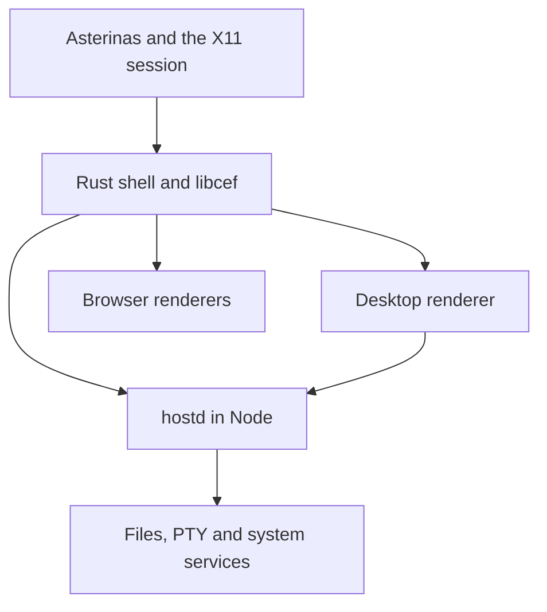

# OpenShell Native — Migrating from Electron to CEF

**Architecture decision · November 11, 2026**  
**Status** Experimental implementation, with adoption conditional on validation on Asterinas.

OpenShell Native's target becomes a userspace shell that embeds Chromium through the **Chromium Embedded Framework (CEF)**. The Rust shell, provisionally called `openshell-shell`, manages the graphical session and integrates the existing UI with the system. Chromium stays multi-process. The current Node.js `hostd` stays as the local services process in the first version.

This document updates the direction of the graphics, Desktop integration and supervision stages of the [original plan](ARCHITECTURE.md). The OpenShell Live edition, based on Debian, remains the functional reference and the fallback option, with the existing Electron. The Linux ABI, storage, installation, A/B update and recovery milestones remain as defined in the original plan. Section 10 records the evidence on Linux and in the Asterinas guest.

## 1. Decision and alternatives

| Option | What it offers | Decision |
| --- | --- | --- |
| CEF in a custom shell | The `libcef` library, a C API, Chromium subprocesses and control over browser creation, navigation and native integration. | Target for the Native edition. |
| Chromium in kiosk mode | A ready-made browser window to load the UI and measure the engine's basic compatibility. | Optional probe for diagnostics. The integrated Browser needs control over views, context and navigation that the shell will have to expose. |
| Chromium Content API | Low-level integration with Chromium's multi-process rendering layer. It means taking on the maintenance of the embedder and the matching build. | Reconsider if an essential requirement arises that CEF cannot meet. |
| Existing Electron | The current Desktop implementation, with the system bridges and the integrated Browser already available. | Behaviour and performance reference on OpenShell Live during the transition. |

The decision gives Native control over the session lifecycle, the Browser surfaces and the privilege boundary. The gains in size, RAM and boot time must be measured. The CEF distribution still includes Chromium, subprocesses and resources, and Node is still needed for `hostd` at this stage. [Components of a CEF application](https://github.com/chromiumembedded/cef/blob/master/docs/tutorial.md) · [Chromium Content Module](https://chromium.googlesource.com/chromium/src/+/HEAD/content/README.md)

## 2. Components and responsibilities

| Component | Responsibility |
| --- | --- |
| Asterinas and Linux userspace | Boot, Linux ABI, kernel isolation, memory, IPC, input and video devices. The first graphics profile uses X11, DRM/KMS and software rendering according to the stack available in the guest. |
| System session | Start the graphical session, set up the user and directories, require native authentication in installed mode and supervise the shell. |
| Rust shell | Initialise CEF, create views, apply navigation and permission rules, translate input and geometry, mediate native operations and control the end of the session. |
| CEF/Chromium | Rendering, JavaScript, workers, web networking, per-context storage, renderer and GPU subprocesses. |
| Shared UI | Desktop, sessions, Files, Terminal, Coder, Browser, tools and the other apps. The Desktop bridge implementation is selected by the runtime environment. |
| `hostd` and `@openshell/host-api` | Serve the bundle and provide the existing protocol for system operations. `hostd` stays in Node; an eventual Rust port is a separate decision. |

The initial session keeps using the init available in the guest. The shell alone is responsible for the `hostd` it starts. External supervision watches the shell and its readiness. If `hostd` supervision moves to the session service, the change must transfer ownership of the process and define how the shell reconnects. Record session errors with a diagnostic state independent of the renderer.

## 3. From Electron integration to CEF integration

The survey of the current code starts from `openshell/apps/desktop/electron/{main,preload,guestPreload}.ts`, `apps/desktop/src/{host,windows}`, `apps/desktop/hostd/{main,server}.ts` and `packages/host-api/src/{client,methods,protocol}.ts`.

| Existing integration | Target in the Native edition | Evidence of parity |
| --- | --- | --- |
| `BrowserWindow`, fullscreen, display and lifecycle | A native shell window, with the Desktop view and observation of display changes. | Start at boot, restore focus after dialogs and leave fullscreen correctly. Test fractional scaling and more than one display after the first profile. |
| `contextBridge` and `window.openshellElectron` | A TypeScript adapter for the shell's capabilities. An asynchronous CEF bridge restricted to the Desktop's main frame. | Open the existing UI, validate the handshake, events, cancellation and the answer to unavailable capabilities. |
| `<webview>` and `guestPreload` | CEF Browser instances managed by the shell. Browser-specific events go through restricted handlers. | Tabs, history, reload, opening a new window, loading state, renderer failure and recovery. |
| `session`, profiles and cookies | Separate request contexts for the Desktop, the normal Browser and private browsing. | Web sign-in stays in the normal profile, a private window starts empty, the shell's cookies stay in the internal context. |
| Downloads, permissions, pop-ups and menus | CEF handlers with product policies and a native authorisation UI. | Concurrent downloads, cancellation, chosen directory, per-origin permission and pop-ups correctly tied to their context. |
| Clipboard, shortcuts, media and IME | Graphical session services and calls explicitly authorised by the bridge. | Per-user actions, correct focus and no events delivered to a background tab. |
| Embedded Linux apps | Keep Xpra on the Linux apps track and integrate the matching surface in the shell. | Launch a real GTK or Qt app, interact with it, resize it and close it without orphan processes. |

Use the existing types and integration points whenever the semantics match. A facade compatible with `window.openshellElectron` can ease the first prototype if it exposes only the implemented methods. The target is a common, versioned capability contract, with Electron and CEF adapters. Methods with Electron-specific semantics must have equivalent behaviour demonstrated before they enter the CEF adapter.

### Rust and CEF integration

1. First run the selected SDK's `cefsimple` to isolate dependencies on X11, the dynamic loader and the sandbox. The Rust application comes after the minimal comparison with the reference binary.
2. Pin the CEF/Chromium version, headers, bindings and the matching resources. Use the C API with bindings generated from those headers, or a narrow C++ adapter if some integration point makes that option simpler. Validate the version and ABI compatibility at build time and at startup. [CEF API versioning](https://chromiumembedded.github.io/cef/api_versioning.html)
3. Structure the entry point according to the CEF lifecycle. Call `cef_execute_process` to tell the subprocesses apart. The main process initialises CEF, creates the first view once the context is available and controls the message loop. Shutdown closes the browsers, waits for the close callbacks and only then shuts down CEF.
4. Confine the FFI to one module, with explicit rules for references, ownership, strings and callbacks. Move blocking work off CEF's UI and I/O threads. No panic may cross the FFI boundary. Respect the thread each API requires and invalidate pending messages when the view is destroyed. [CEF processes, threads and lifecycle](https://chromiumembedded.github.io/cef/general_usage.html)
5. Implement the first capabilities as asynchronous contracts. A request carries a version, ID, method and parameters. The response carries a result or a typed error. The shell limits payloads, validates the schema, applies per-method authorisation, enforces a deadline and discards responses for frames that have lost their authorisation. [IPC and JavaScript in CEF](https://chromiumembedded.github.io/cef/general_usage.html#asynchronous-javascript-bindings)

## 4. Desktop origin, hostd and isolation

### Bootstrap and bridge

`hostd` already emits `OPENSHELL_HOSTD_READY` with an authenticated initial URL. Its server exchanges the token for an `HttpOnly`, `SameSite=Strict` cookie and validates the origin of protocol connections. The first CEF adapter keeps the bundle served by `hostd`, the existing transport and the authentication flow, reducing the initial changes to the UI.

1. The session starts the shell with controlled directories and arguments. The shell starts `hostd`, reads the readiness signal, validates the URL as loopback on the expected origin and applies a startup timeout.
2. The shell opens the initial URL in the context reserved for the Desktop. The URL with the token is restricted to the bootstrap and must be hidden from logs, reports, menus and information exposed to the Browser. After the exchange for the cookie, the credential stays in the internal context and navigation continues on the authorised origin.
3. The frontend uses the `@openshell/host-api` contract for services that already exist. CEF IPC covers operations that belong to the window or the session, such as opening a tab and positioning a view. The browser's identity, the main frame, the effective origin and the navigation state are checked in the main process, using CEF's information.
4. The bridge revokes capabilities on navigation, reload, frame teardown and loss of the session. When `hostd` restarts, the shell redoes the bootstrap and the renderer reconnects with a new session. The system discards calls in flight and reports failures of operations that need intervention.
5. For installation, define a stable origin per profile or an explicit migration strategy before enabling real data. A change of host, port or scheme affects cookies and web storage. The prototype may use ephemeral ports with disposable profiles.

An internal origin registered in CEF may be evaluated later to serve system resources. That requires designing the secure context, storage, CSP, fetch and compatibility with the `hostd` transport. The origin must preserve privilege separation and the working of workers, WebAssembly and the editor's resources. [Schemes and resources in CEF](https://github.com/chromiumembedded/cef/blob/master/include/cef_scheme.h)

### Browsing contexts and authorisation

| Context | Storage | Privileges |
| --- | --- | --- |
| Desktop | Its own profile with the bundle's data and the `hostd` session. | Only the trusted UI and its main frame receive the capabilities defined for the Desktop. |
| Normal Browser | A profile separate from the Desktop, shared only by the normal session's tabs. | Navigation handlers and per-origin web permissions. The shell's policy blocks access to `hostd`'s private endpoint. |
| Private Browser | An ephemeral context, discarded when the private session ends. | The same privilege boundaries as the normal Browser, with its own storage. |
| Embedded third-party apps | A context according to the app's identity and policy. | Explicit, revocable capabilities. The embedded frame uses the app-specific interface. |

Validate the boundary in the main process for every call. Data received from pages, subframes, pop-ups, navigation callbacks or renderer parameters goes through validation. `hostd` keeps its authentication and its origin and access checks. The CEF client separates cookies and blocks Browser navigation, resources and redirects that reach the internal origin. Tests must cover loopback aliases, redirects, subresource requests, WebSocket attempts and resumption after a page change. The policy for the user's local sites may allow development addresses, with specific protection for OpenShell's private services. [Request contexts in CEF](https://github.com/chromiumembedded/cef/blob/master/include/cef_request_context.h)

## 5. Browser composition and input

The current UI arranges windows in the DOM. With CEF, the shell has to bind each logical window to a browser view. A native view is a surface of the shell's window, with its own geometry, focus and stacking. The first proof uses one tab and a rectangular region controlled by the shell.

1. The UI publishes the active window's rectangle, scale, visibility, order and focus through a typed operation. The shell validates the bounds against the usable area and associates the data with the logical window's ID.
2. The shell converts between CSS pixels, window units and physical pixels once per update. DPI, display, movement or zoom changes invalidate the previous geometry.
3. Input goes to the visible, focused view. The UI keeps control of the window title, the dock and global shortcuts. Minimising, switching workspaces and closing a tab revoke the corresponding input capture.
4. During modals, menus and animations over the page, the compositor must respect the UI's visual order and clipping. Test form pop-ups, context menus, drag and drop, keyboard, IME, selection and accessibility in the full flow.
5. The fullscreen stage validates entering, leaving, restoring geometry and recovering focus on one display. Then add the dual-monitor case and check the behaviour at different scales.

Start with `CefBrowserView` or an equivalent native view offered by the pinned SDK. If view composition cannot preserve the Desktop's stacking and clipping, test **off-screen rendering** for the Browser. On that path, the shell receives frames and damaged regions and forwards input to CEF. The frame queue must be bounded and drop old frames, especially during resize and scrolling. The initial proof may use software rendering. Acceleration and buffer sharing depend on the combination of CEF, Ozone, Mesa and the guest's drivers, and must be measured before adoption. [BrowserView API](https://cef-builds.spotifycdn.com/docs/147.0/classCefBrowserView.html) · [Off-screen rendering in CEF](https://chromiumembedded.github.io/cef/general_usage.html#off-screen-rendering) · [Render callbacks](https://github.com/chromiumembedded/cef/blob/master/include/cef_render_handler.h)

The choice of composition is only settled after testing a tab with a Worker, a modal window over the page and an animation that moves and resizes the Browser. The result must record input latency, CPU use, frame rate and visual quality compared with Electron on the same hardware or VM profile.

## 6. Sandbox and kernel requirements

CEF uses Chromium's multi-process sandbox. On Linux, the layers in effect depend on the version and on the system's capabilities. The pinned Asterinas revision does not implement `seccomp`, `PR_GET_SECCOMP` or `PR_SET_SECCOMP`. The [patch series](kernel/patches/README.md) adds those operations, and the seccomp probe proves in the guest that filters are installed and applied. The same revision rejected new user, PID and network namespaces, which form the other layer of Chromium's sandbox. The series also adds those namespaces, and the namespace probe proves the isolation of identity, processes, network and abstract sockets. A positive result in these probes is evidence of a kernel operation. Approving the Desktop requires proof of isolation in the real Chromium process. [CEF sandbox on Linux](https://chromiumembedded.github.io/cef/sandbox_setup#linux) · [Chromium's Linux sandbox](https://chromium.googlesource.com/chromium/src/+/HEAD/sandbox/linux/README.md) · [Operations documented for Asterinas](https://asterinas.github.io/book/kernel/linux-compatibility/syscall-flag-coverage/namespaces-cgroups-and-security/)

| Proof | Evidence required |
| --- | --- |
| ABI and basic services | Loading `libcef` and its dependencies, threads, shared memory, signals, IPC and Unix sockets, rendering and input. Use logs and identify the first incompatible syscall or operation. |
| Kernel sandbox | Run the runner's `sandbox` mode and keep the log of the filter being applied. Validate the namespaces and the other mechanisms used by the pinned CEF distribution. |
| Chromium sandbox | Start as a regular user with the sandbox policy enabled. Confirm that the subprocesses are created and record the evidence of the renderers' filtering and isolation. When running under an external sandbox, distinguish the host's restrictions from those applied by Chromium. |
| Bridge boundary | Try to call native operations from a site, an iframe, a pop-up, a private tab and a document navigated to another origin. The operations must be denied and the Desktop session must remain usable. |
| Privileged operations | Confirm the policy and consent for downloads, file access, clipboard, opening apps and system changes. The Browser receives only the web capabilities and product actions authorised for its context. |

Run the proofs first on a control Linux, then on Asterinas with the same CEF distribution and configuration. Approval requires an effective sandbox and tested boundaries. If the guest fails, record the incompatible operation, reduce the case and consider an upstream fix or a version change. External browsing and adoption as the production runtime depend on the result.

## 7. Build, distribution and lifecycle

- Pin the source, version, architecture and checksum of the SDK and of the OpenShell bundle in reproducible manifests. Use the same Asterinas revision in comparison tests until evidence justifies a change.
- Package `libcef`, the executable or subprocess helper, resource files, locales, ICU data and the other files the chosen SDK requires. Validate the dynamic dependencies and their paths in the Native rootfs. Also record the graphics backend and the versions of the libraries used.
- Run the CEF smoke on a clean rootfs. The result must prove that the image contains the needed dependencies and resources. Record the effective CEF/Chromium version, the UI build ID, the Node version and the kernel ID.
- Keep profiles, regenerable caches and UI data in identifiable directories. Keep the CEF profile separate from Electron's and preserve the origin's identity. Import data only through known contracts, starting with preferences, bookmarks and OpenShell's own data. Cookies, Chromium profiles and credentials need a specific strategy and a return test.
- Integrate the runtime into the release manifest and Native's A/B updates. The kernel, userspace, shell, CEF, UI and `hostd` set must have identifiable compatibility. Test a new version with an isolated user profile before confirming the slot. OpenShell Live remains available as a way back during the migration.
- Follow Chromium and CEF security updates, revalidate the dependencies and keep licence notices, the SBOM and checksums with the build. Use the A/B mechanism to return to the last approved release on a regression.

Proposed code layout when implementation starts:

| Location | Contents |
| --- | --- |
| `userspace/shell/` in Native | The Rust process, CEF integration, session rules and view management. |
| `graphics/kiosk/` in Native | X11 session configuration, graphics profiles and the shell launcher. |
| `tools/desktop/` and `tests/` in Native | CEF tests and parity tests against the Electron reference already available. |
| `apps/desktop/src/host/` in OpenShell | The capability contract and frontend adapters, after identifying the current coupling points. |
| `openshell/integration/` in Native | Integration of the UI bundle and `hostd` with the shell and the system image. |

## 8. Phases and criteria for moving on

| Phase | Delivery | Criterion for moving on |
| --- | --- | --- |
| 0 · References | Results of `smoke`, `control`, `compat` and `sandbox` on Native, plus the Electron reference behaviour on OpenShell Live. | Build IDs and logs kept. Diagnosis of the ABI and isolation blockers. |
| 1 · Minimal CEF | `cefsimple` with a local fixture on X11 on the control Linux and in the Asterinas guest. | The window appears, receives keyboard and mouse, renders and closes. Subprocesses and the sandbox are proven. |
| 2 · Rust shell and Desktop | FFI, CEF lifecycle, session, `hostd` bootstrap and the real UI. | Desktop, Files and Terminal start. Restarting `hostd` and the renderer recovers the session with observable errors and without leaking credentials. |
| 3 · Integrated Browser | A CEF tab managed by the shell, a separate context, input, geometry and Web Worker. | Tab, Worker, modals, resize, focus changes and the bridge's negative cases pass. The composition serves the current UI. |
| 4 · Desktop parity | Normal and private tabs, downloads, pop-ups, permissions, fullscreen, shortcuts and clipboard. | The scenario matrix passes on Native and is compared with Electron. Differences have explicit product decisions. |
| 5 · Installable candidate | Packaged runtime, persistence, A/B updates and recovery in a VM. | Repeatable boot and update. Profiles preserved or migrated, rollback validated and the runtime release traceable. |

The `sandbox` mode and the [Electron smoke already implemented](tools/desktop/smoke.mjs) are starting points for the proofs. The Electron test remains the reference. The CEF smoke must produce its own report with the kernel revision, SDK version, composition type, graphics backend, isolation results, log and a capture of the fixture.

To compare performance, record boot to the first usable frame, time to an authenticated `hostd`, the first tab, RAM use at rest and with tabs, frames during resize and recovery from a failure. Use the same fixtures, resolution and CPU/RAM allocation. Measure CEF and Electron first on the same control Linux to isolate the runtime difference. Measure Native separately to observe the cost of the kernel and the graphics stack. Set limits after measuring the reference. Repeat the tests when changing the kernel, CEF, renderer or rootfs.

## 9. Decisions conditional on the first results

| Decision | Evidence needed |
| --- | --- |
| CEF version and distribution | SDK compatibility on the control Linux and on Asterinas, security maintenance and packaging requirements. |
| Native view or off-screen | Correct stacking and clipping, input and performance in the embedded Browser. The first composition uses overlaid native views (section 10). |
| Internal origin for the Desktop | Preservation of storage, CSP, workers and the `hostd` transport, with a tested policy for external origins. |
| Kernel gaps | A reproducible difference between Linux and Asterinas, with a minimal case and impact on the sandbox or on the UI's operation. |
| Profile migration | List of supported data, tested export or migration and a way back to the last working release. |

## 10. Implementation status

The proofs below pass on the control Linux, with Chromium's sandbox in effect, and in the Asterinas guest with the [patch series](kernel/patches/README.md). The [README](README.md) lists the commands and the reports.

**Phase 1.** The shell's host replaces `cefsimple`, which nixpkgs' CEF does not include. The `graphics` action opens the fixture in an X11 window and checks mouse, keyboard and Web Worker. The `isolation` mode uses two contexts side by side and requires cookie and request isolation before and after the window is resized. In both proofs, the renderers run with Chromium's sandbox.

**Phase 2.** The Rust launcher starts `hostd`, validates its readiness and opens the real Desktop bundle in the Desktop context, whose profile lives in `cef/desktop`. The [shell smoke](tools/desktop/shell-smoke.mjs) uses only X11 input and what `hostd` writes to disk:

- Desktop: the UI writes the default documents through `hostd`.
- Files: Ctrl+A, Enter and F2 rename a test file.
- Terminal: a typed command runs in `hostd`'s PTY.
- Recovery of the renderer and of `hostd`, with the Terminal working again after each.
- Clean shutdown and a second session on the same profile.
- No log contains the bootstrap URL.

The launcher restarts `hostd` up to 5 times a minute, with an increasing wait, on the same port and with the same origin. The CEF host's stdin stays open as a control channel. Through it, the launcher sends the new bootstrap, and the host only accepts a bootstrap URL on the original origin. When the launcher closes the channel, the session ends. The host reloads the Desktop up to 3 times a minute when the renderer dies and reactivates the window: the view keeps Views' focus, but the new renderer does not receive it. `hostd`'s errors go to `hostd.log`, in the session state. The bootstrap secret travels only through pipes.

**Phase 3, composition.** The Browser's tabs are host views overlaid on the window (`CefWindow::AddOverlayView`, custom mode), in the rectangle of the tab's element. The UI publishes in `browser/layout` a snapshot of the session with an increasing generation, visibility, each tab's rectangle and, the first time an active tab is shown, an optional focus request. The host validates the snapshot before applying it, discards stale generations and hides the outgoing views before showing the incoming ones in the same CEF task. `hello` announces `surfaceLayout` and `shortcutPhases`. Older bundles keep using `browser/bounds` per tab.

- **Bridge.** The Desktop page sends `POST /_shell/<command>`. The host answers in the main process and never forwards the request to `hostd`. Only the main frame of the Desktop's browser is accepted; frames, tabs and navigations get 403. The tabs' events reach the page as `openshell-native-browser`. The adapter lives in `apps/desktop/src/host/nativeBrowser.tsx`, in the `openshell` repository. The Browser uses the same tab component as Electron, with an element that implements the `<webview>` interface.
- **Contexts.** A normal tab uses the `cef/browser` profile, separate from the Desktop. A private tab uses an in-memory context, discarded when the private session ends.
- **Policy.** Tabs open http(s), `about:blank` and the user's local services. No loopback alias reaches `hostd`'s port: `localhost`, `*.localhost`, `127.0.0.0/8`, `0.0.0.0`, `[::1]` and the mapped IPv4. Other schemes, such as `file:` and `chrome:`, are refused. Pop-ups and links to a new window open a tab, created by the Desktop.
- **Visibility.** A tab can stay visible behind another window when the areas do not overlap. The UI checks the rectangles of windows above and of elements such as address bar suggestions, menus and the window switcher. For other elements, it queries `elementFromPoint` on a grid with a margin for the resize handles. A Desktop dialog can suspend presentation. The UI delays re-showing a hidden tab while an editable field or iframe of the Desktop holds the keyboard, because showing the CEF overlay can take the focus. Clicking a visible view activates its logical window.
- **Keyboard.** The Desktop registers the shortcuts it shares with the tabs and says which ones must move the focus before running. The host forwards key presses and releases to bundles that announce support when subscribing. Ctrl+L moves the focus to the Desktop, which selects the address. The packaged Openbox releases Alt+Tab, Alt+F4 and the Super combinations to OpenShell. The switcher uses the real Alt release. When a focused tab is hidden, the Desktop receives the focus. A tab focused before it has a renderer, such as a pop-up, receives the keyboard when the page finishes loading. After a tab's overlay has had the keyboard, Chromium may leave keys without a target, even though Views counts a browser as focused: they reach the window without going through any browser. The window hands those keys to the focused browser, with the character they type, and leaves alone those a page received and did not handle.
- **DevTools.** The frontend uses a frameless CEF Chrome window, tied to the Desktop's Alloy window. The UI positions the window in the active tab's bottom or side panel and hides it when the panel is covered. The frontend has its own CEF client, and closing the tab ends the associated DevTools.
- **Fonts.** The graphics profile includes Cascadia Code and JetBrains Mono, used by the Desktop, plus Liberation, DejaVu and Noto for fallbacks. The initramfs installs the Fontconfig configuration in `/etc/fonts/fonts.conf` to make the families available offline.

**Phase 4, parity with Electron's main process.** On OpenShell Live, Electron's main process (`electron/main.ts`) offers the UI the `OpenShellElectronApi` interface. On Native, `apps/desktop/src/host/nativeShell.ts`, in the `openshell` repository, implements the same interface over the `/_shell/` bridge, with `isElectron: false`. That way the Desktop's components do not need to tell the two runtimes apart, except at the points that depend on Electron (key forwarding through the main process), which test `isElectron`, not the presence of the bridge. Numeric `webContents` ids become guest ids, which the adapter associates with tabs. In the host, [browser_features.cc](userspace/shell/cef/browser_features.cc) gathers the features, [session.h](userspace/shell/cef/session.h) the state shared with `main.cc`, and the bridge accepts asynchronous answers for commands that depend on Chromium or on an answer from the person.

- **Downloads.** They go to `~/Downloads`, with a sanitised name and without overwriting files. The Desktop receives the progress, with at most one event every 400 ms, and can pause, resume and cancel the download.
- **Prompts.** The Desktop answers camera and microphone requests and file selection, through OpenShell's chooser, both for the tabs and for the Desktop page itself. Camera and microphone answers apply per site for the session, separate in the private window. Other permission requests are refused, as on Live.
- **Certificates.** An untrusted certificate is refused, unless the person opens an exception for that host and that fingerprint.
- **DevTools protocol.** The agent's tools use `ExecuteDevToolsMethod`, limited to a list of methods: evaluation, capture, PDF, synthetic input and cache clearing in the tabs, and only capture and input on the Desktop page.
- **Printing.** Ctrl+P exports the tab to PDF, in `openshell-print` in the temporary folder, and the Desktop opens the file.
- **Captures.** The shell's capture combines the Desktop page's image with each visible tab, in the rectangle of the last applied layout, and recomposes the overlays inside that rectangle. That way, Print and Shift+Print include the tabs and the notifications that pass over them.
- **Tooltips.** Chromium draws a `title` tooltip in a plain white box, outside the theme. The host turns that box off for the Desktop page (`OnTooltip`), which draws its own in the theme's colours (`apps/web/src/lib/themedTooltips.ts`, in the `openshell` repository, also on Live and the web), and forwards a tab's tooltip with the pointer's position (the `tooltip` event): the Desktop draws it the same way, above the tabs like the notifications.
- **Clipboard.** An XFixes observer, with its own thread and X connection, receives every system copy, as UTF-8 text or PNG, including through INCR transfers, up to 1 MB of text and 16 MB of image. The Desktop keeps the copy in the history, except when the program marks it as secret. Super+V, in a tab or on the Desktop, opens the history, and pasting returns the item to the tab or field where the key was pressed.
- **Hardware keys.** Volume, mute and brightness follow `shared/hardwareKeys.ts`, even when a tab has the keyboard. The OSD appears over the tab, which stays visible and keeps the keyboard.

The smoke opens a site with the Terminal's `xdg-open` and proves:

- the page and a Web Worker;
- WebGL;
- trusted clicks and keys, navigation typed after Ctrl+L, the switcher's priority over the tab with Alt held and clicks working again after dismissing the switcher;
- Alt+S pressed in a pop-up opens the Desktop search, and the text typed next reaches it;
- zoom and download to the disposable profile's `Downloads` folder;
- transparency of the download notification's rounded corner over the tab and the brightness indicator showing;
- opening DevTools with F12, running a command in the tab's console and closing it with F12 from the panel itself;
- selecting files for a tab's `<input type=file>` through OpenShell's chooser, without a new X window;
- Ctrl+P produces the tab's PDF;
- Shift+Print saves a capture in which the tab's pixel has the page's colour;
- text copied in the tab goes to the clipboard history and is pasted with Super+V;
- a pop-up opened as a tab;
- filtered renderers;
- that the page cannot reach `hostd`.

Known limits of this composition:

- **WebSocket.** CEF's resource API does not intercept the WebSocket handshake. `hostd` refuses a foreign origin without a cookie and closes the socket before the first message, and the smoke requires that result.
- **DNS rebinding.** The host's block compares the URL's literal address. A domain that resolves to loopback on `hostd`'s port gets through CEF. When it listens on loopback, `hostd` answers 421 to any `Host` other than `127.0.0.1`, `localhost` or `[::1]` on its port, and refuses the WebSocket upgrade in that case.
- **Overlap.** Menus, dialogs and windows that cross the tab hide the whole CEF view, without partial clipping. In its place, the Desktop shows the capture of the page taken before hiding it, and the page stays visible, frozen, under whatever covers it; the view comes back, live, when nothing covers it. Elements outside the known types that are smaller than the grid spacing may escape detection.
- **Shortcuts.** Delivery depends on the keys that reach CEF through X11. Sessions with another window manager may capture keys before CEF. Other keyboard layouts and IME still need validation.
- **Browser features.** Camera and microphone answers last until the session ends, as on Live, which also forgets them on restart. The tab's audio indicator is also missing, because CEF 147 does not expose whether a tab is playing sound. Mute works. The camera and microphone prompt has no proof in the smoke, because the VM has no devices.
- **Dock thumbnails.** There are no window thumbnails in the dock (`captureRect`). Capturing the Desktop page every few seconds turned the screen black during the capture.
- **Transparent overlays.** The OSD, the password pop-up and the notifications are drawn as PNG images with transparency over the tabs. The composition preserves the CSS corners. The clip still ends at the element's rectangle, and the blur of the tab's background is not part of the image.
- **One display, no lock.** Native shows a single display, and without `screens` the Desktop keeps that behaviour. Live's screen lock (`onScreenLocked`) depends on native authentication.
- **Fullscreen and recording.** A fullscreen page covers the whole screen, as on Live: the host notifies the Desktop (`OnFullscreenModeChange`), which takes the tab to the whole screen, and Escape or switching windows ends it. While the tab covers the Desktop page, Chromium counts it as hidden and gives it no frames: the layout follows a timer. Screen recording uses the whole X screen as its source (`screen:-1:0`), which the kiosk window fills, and the Desktop page receives camera, microphone and screen without asking, as on Live.

Off-screen composition remains the alternative if overlaying elements proves insufficient.

**Linux apps.** The Desktop integrates Xpra through `hostd`, as on OpenShell Live: for each app, `hostd` starts an Xpra server with its own Xvfb, password-protected and bound to loopback, and the OpenShell window shows Xpra's HTML5 client in an `iframe` served by `hostd`. The `apps` action adds the apps profile of [initramfs.nix](userspace/compatibility/initramfs.nix) to the image: Xpra 6.4 with Xvfb, the HTML5 client 17.1, D-Bus, the Python with dbus-python and PyGObject that `hostd`'s portal uses, and two test apps, one GTK 3 and one Qt 6, in [probes](userspace/compatibility/probes). The image puts the HTML5 client, the D-Bus session configuration and the `.desktop` entries where `hostd` and D-Bus look for them on Debian.

Making the path work with these versions required fixes in `hostd` and the UI, in the `openshell` repository:

- the socket authentication uses `auth=file,filename=…`; Xpra 6.4 ignores the `auth=file:filename=…` form and then refuses every password;
- the server gets `XPRA_DELAY_KEYBOARD_DATA=0`; without it, Xpra 6 only applies the client's keymap when the client reports a keymap change, which the HTML5 client never does, and every key resolves to nothing;
- the app launcher names `hostd`'s `python3` and `dbus-run-session`, because Xpra's Nix wrapper puts its own Python in the children's PATH;
- the UI reads the client's window types in both forms, a list or a single value (client 17 removed `has_windowtype`), and gives the keyboard to the app's window when it appears and when it is clicked, because the client only focuses a window through its title bar, which OpenShell hides;
- Desktop shortcuts pressed inside the app go to the Desktop, through the same `shellKeys` definitions, when there is no Electron to forward them;
- the launcher passes `XDG_DATA_DIRS` on to `hostd`;
- `cursorTheme.py` loads the X libraries from the folders in `OPENSHELL_X11_LIBRARY_PATH`, which the profile's Python wrapper sets, and also looks for icon themes in the `icons` folders of `XDG_DATA_DIRS`. The profile includes Adwaita, from which the script draws OpenShell's cursor, and `xsettingsd` and `xrdb`, with which it hands it to the toolkits;
- when Xpra dies, `hostd` ends the app's whole session (every process with the same session ID), because Xpra puts its Xvfb in a process group of its own, which used to outlive it;
- on the Desktop page, the shell's Alt shortcuts (search, switching and closing windows) reach the shell's listeners before the fields, as on Live, where Electron diverts them. Before, the Terminal received the "s" of Alt+S while the search opened.

The [apps smoke](tools/desktop/apps-smoke.mjs) proves through `hostd`'s API the catalogue, launching, the client page, the WebSocket to Xpra and the password the UI receives, OpenShell's cursor in the app and shutdown without orphans (app, Xpra and Xvfb) from the Desktop, from the app itself and when Xpra is killed. The `linux-apps` phase of the Desktop smoke opens both apps from the search, types in the OpenShell window, maximises with Super+↑ and requires the app to take the size, and closes the GTK one with Alt+F4 and the Qt one from the app itself. In GTK, a dialog appears in the OpenShell window and receives the keyboard, and text copied in the app reaches the clipboard history and comes back to the app with Super+V. Finally, a document of a type only the GTK app declares opens in it through the Terminal's `open` and through Enter in Files, with the file as its argument.

**Graphics.** The image includes the pinned nixpkgs' Mesa in `/run/opengl-driver`, as on NixOS. Xvfb offers GLX, and ANGLE renders with llvmpipe. The host passes `ignore-gpu-blocklist`, because Chromium's blocklist, made for unknown drivers, refuses WebGL on llvmpipe and the image pins the driver. The smokes record the effective renderer and check a pixel read back.

**Supervision (stage 5 of the original plan).** `openshell-session` runs as an init service, as root:

- after creating the home and the log directory, it keeps only `CAP_SETUID`, `CAP_SETGID`, `CAP_KILL` and `CAP_FOWNER`;
- it starts X, Openbox and the launcher as the session user, each in its own process group;
- it waits for the X socket before starting the rest;
- it restarts the shell up to 5 times a minute and the window manager up to 5 times a minute;
- when X dies, it restarts the whole session, up to 3 times in 5 minutes;
- as a subreaper, it reaps the session's orphans;
- it ends the shell, the window manager and X in that order;
- it keeps each boot's logs in a directory of their own and keeps the 5 most recent.

The [session smoke](tools/desktop/session-smoke.mjs) checks the supervisor's capabilities, kills the CEF host and requires a new session, with no processes from the previous one. Then it requires SIGTERM to end every process of the session. The shell smoke records memory (sum of RSS and PSS, when the kernel reports it) and CPU time of CEF and `hostd` with the Desktop ready, with the Browser open and at rest.

**Contracts and baseline.** The `@openshell/host-api` contract tests live in `apps/desktop/hostd/contract.test.ts`, in the `openshell` repository, and talk to hostd through the UI's own `HostClient`, over a real WebSocket: files (writing, ranged reads, listing, copying, renaming, removal and error codes), `exec` with cwd, stdin, timeout and cancellation, the terminal, folder watching, the password service, metrics, unknown methods, refusing the socket without a token or from another origin and the HTTP routes with the session cookie. By default they bring up the Node hostd in-process; with `OPENSHELL_CONTRACT_URL`, `OPENSHELL_CONTRACT_TOKEN` and `OPENSHELL_CONTRACT_ROOT` they run against another implementation, such as a Rust service port, started with `--home <root>/home --ui <root>/ui` in dev mode.

On the control Linux (Xvfb 1280×800, llvmpipe), the shell smoke measures the CEF side:

| Moment | CEF: processes, RSS/PSS | hostd: RSS/PSS |
| --- | --- | --- |
| Desktop ready (window at 316 ms, UI at 566 ms) | 9 processes, 1110/649 MiB | 108/79 MiB |
| With the Browser open | 12 processes, 1733/974 MiB | 144/96 MiB |
| At rest, at the end of the phases | 10 processes, 1710/1173 MiB | 111/74 MiB |

The same measurement for Electron 44.5.1 from `BUILD.json`, on the same control, is missing: the Linux bundle does not ship Electron's executable, and the control does not have it.

## 11. Decisions and next steps

The evolution proposal of 11/12/2026 (*OpenShell Native — Proposed final architecture and optimisation opportunities*) was evaluated against the implementation. The decisions below hold until a measurement reopens them.

| Decision | Status |
| --- | --- |
| The UI defines the layout, and the shell validates and presents the surfaces | Adopted. Tabs send rectangle, visibility and focus request in one snapshot per generation. The UI uses z-order to decide which rectangular views may appear. Partial clipping, scaling and a second kind of surface are still pending. |
| Overlaid views as the base composition, with off-screen only if overlaying is not enough | Adopted. Off-screen composition and a custom compositor depend on measuring copies, CPU, latency and dropped frames. |
| X11 and Xpra kept until an alternative reaches parity | Adopted. Openbox and Xorg only leave the path once Linux apps have another validated path. |
| `hostd`'s protection independent of the block in CEF | Adopted: Origin, cookie and `Host` validation. |
| `hostd` in Rust | Conditional on the `@openshell/host-api` contract tests, ported method by method with both implementations under the same tests. `hostd-smoke` is the seed of those tests. |
| Native CEF IPC instead of `/_shell/` | Conditional. It needs a handler in the renderer process. The current HTTP bridge accepts only the Desktop's main frame and only `POST`. |
| Assets served by an internal CEF scheme | Experiment. It changes the origin of the Desktop profile and needs a migration plan for storage and cookies. |
| A/B rootfs separate from the Debian compatibility layer | Adopted in the design of `distro/ab`: the slots hold the base, and Debian apps and packages live in an updatable area with its own rollback. |

Next steps, in order:

1. ~~Linux apps~~: done. Opening from the Terminal and from Files, recovery when Xpra dies, dialogs, clipboard and the app's cursor have proofs in the smoke (section 10).
2. ~~Surface contract~~: done. Xpra windows are part of the Desktop's DOM and follow its z-order and clipping. On tabs, whatever covers the view shows the page's capture in its place, the parts of the Desktop that sit above them (OSD, login list, notifications) are images above the views with clicks handed back to the Desktop, and fullscreen takes the tab to the whole screen. The clipboard goes through the history in both directions. Dragging from Files carries only OpenShell's internal data, as on Live. Left out: dual monitors (Native has one display) and IME (the session has none).
3. ~~Browser parity~~: done. Password vault, OSD and notifications over the tabs, fullscreen and screen recording are done; permissions follow Live, which does not keep them between sessions. The shortcut matrix is an `openshell` test (`shared/nativeKeyRoutes.test.ts`): every Browser shortcut, on every printable key and every modifier combination, reaches the Desktop from a focused tab, as on Live. The test found Ctrl++ and Ctrl+_ off the route. The shell smoke switches the layout to `de` and checks Alt+S and the text typed in the Terminal.
4. The `host-api` contract tests (done, section 10) and the Electron measurement on the same control Linux, which depends on the Linux executable of Electron 44.5.1, before porting `hostd` services.
5. ~~Native authentication before the session and Xorg on DRM~~: done. The supervisor starts the Desktop as a greeter and only starts the shell after the password, with the hash kept by root ([README](README.md#sign-in)). Xorg uses `modesetting` on simpledrm and `evdev` without udev, as the session user ([README](README.md#screen-keyboard-and-mouse)).
6. ~~A/B image and installer~~: done. The experimental image integrates the `system_a`, `system_b`, `recovery` and `data` partitions, slot selection in GRUB and the signed update of the inactive slot while running, and the `desktop-image` action exercises the confirmation tied to the installed Desktop's health ([README](README.md#ab-updates)). The live stick installs the system to the internal disk from the Desktop, like Calamares on Live, and the installed disk boots on its own through the signed chain ([README](README.md#installation)). Session parity with Live includes the loading screen, sign-in, the screen lock and shut down/restart ([README](README.md#loading-screen), [lock](README.md#screen-lock-and-power)).
