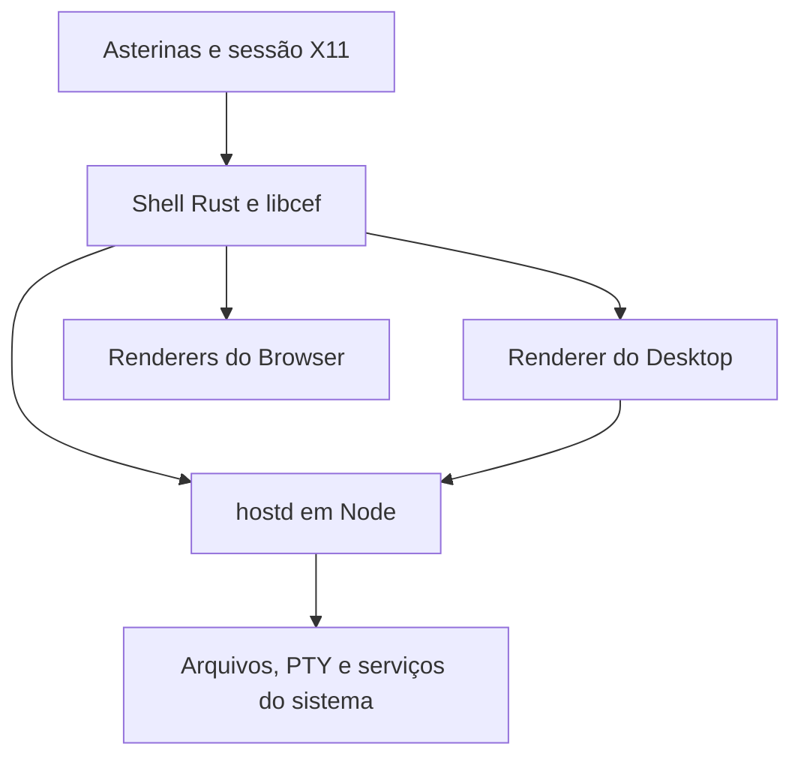

# OpenShell Native — Migração do Electron para CEF

**Decisão de arquitetura · 11 de novembro de 2026**  
**Status** Implementação experimental, com adoção condicionada à validação em Asterinas.

O alvo do OpenShell Native passa a ser um shell em espaço de usuário que incorpora Chromium via **Chromium Embedded Framework (CEF)**. O shell em Rust, provisoriamente chamado `openshell-shell`, gerencia a sessão gráfica e integra a UI existente ao sistema. Chromium continua multiprocesso. O `hostd` atual em Node.js continua como processo local de serviços na primeira versão.

Este documento atualiza a direção das etapas gráficas, de integração do Desktop e de supervisão do [plano original](ARCHITECTURE.md). A edição OpenShell Live, baseada em Debian, continua como referência funcional e opção de retorno, com o Electron existente. Os marcos de ABI Linux, armazenamento, instalação, atualização A/B e recuperação continuam definidos no plano original. A validação do boot real do Native e a execução do CEF no guest ainda estão pendentes.

## 1. Decisão e alternativas

| Opção | O que oferece | Decisão |
| --- | --- | --- |
| CEF em um shell próprio | Biblioteca `libcef`, API C, subprocessos Chromium e controle sobre criação de browsers, navegação e integração nativa. | Alvo para a edição Native. |
| Chromium em modo kiosk | Uma janela de navegador pronta para carregar a UI e medir a compatibilidade básica do motor. | Sonda opcional para diagnóstico. O Browser integrado exige controle de views, contexto e navegação que o shell precisará expor. |
| Chromium Content API | Integração de baixo nível com a camada multiprocesso de renderização do Chromium. Exige assumir a manutenção do embedder e do build correspondente. | Reavaliar se surgir um requisito indispensável que o CEF não consiga atender. |
| Electron existente | Implementação atual do Desktop, com as pontes de sistema e o Browser integrado já disponíveis. | Referência de comportamento e de desempenho no OpenShell Live durante a transição. |

A decisão dá ao Native controle sobre o ciclo de vida da sessão, as superfícies do Browser e a fronteira de privilégios. O ganho em tamanho, RAM e tempo de boot deve ser medido. A distribuição CEF ainda inclui Chromium, subprocessos e recursos, e o Node continua necessário para o `hostd` nessa etapa. [Componentes de uma aplicação CEF](https://github.com/chromiumembedded/cef/blob/master/docs/tutorial.md) · [Chromium Content Module](https://chromium.googlesource.com/chromium/src/+/HEAD/content/README.md)

## 2. Componentes e responsabilidades

| Componente | Responsabilidade |
| --- | --- |
| Asterinas e userspace Linux | Boot, ABI Linux, isolamento do kernel, memória, IPC, entrada e dispositivos de vídeo. O primeiro perfil gráfico usa X11, DRM/KMS e renderização por software conforme a pilha disponível no guest. |
| Sessão do sistema | Iniciar a sessão gráfica, estabelecer usuário e diretórios, exigir autenticação nativa em modo instalado e supervisionar o shell. |
| Shell Rust | Inicializar CEF, criar views, aplicar regras de navegação e permissões, traduzir entrada e geometria, intermediar operações nativas e controlar o encerramento da sessão. |
| CEF/Chromium | Renderização, JavaScript, workers, rede web, armazenamento por contexto, subprocessos de renderer e GPU. |
| UI compartilhada | Desktop, sessões, Files, Terminal, Coder, Browser, ferramentas e demais apps. A implementação da ponte do Desktop é selecionada pelo ambiente de execução. |
| `hostd` e `@openshell/host-api` | Servir o bundle e fornecer o protocolo existente para operações do sistema. O `hostd` continua em Node; eventual porte para Rust é uma decisão independente. |

A sessão inicial continua usando o init disponível no guest. O shell é o único responsável pelo `hostd` que inicia. A supervisão externa acompanha o shell e sua prontidão. Se a supervisão do `hostd` migrar para o serviço de sessão, a mudança deve transferir a propriedade do processo e definir como o shell reconecta. Registrar erros de sessão com um estado de diagnóstico independente do renderer.

## 3. Da integração Electron à integração CEF

O levantamento do código atual parte de `openshell/apps/desktop/electron/{main,preload,guestPreload}.ts`, `apps/desktop/src/{host,windows}`, `apps/desktop/hostd/{main,server}.ts` e `packages/host-api/src/{client,methods,protocol}.ts`.

| Integração existente | Alvo na edição Native | Evidência de paridade |
| --- | --- | --- |
| `BrowserWindow`, fullscreen, tela e ciclo de vida | Janela nativa do shell, com view do Desktop e observação de mudanças de tela. | Iniciar no boot, restaurar foco após diálogos e sair do fullscreen corretamente. Testar escala fracionária e mais de uma tela depois do primeiro perfil. |
| `contextBridge` e `window.openshellElectron` | Adaptador TypeScript de capacidades do shell. Ponte assíncrona CEF restrita ao frame principal do Desktop. | Abrir UI existente, validar handshake, eventos, cancelamento e resposta a capacidades indisponíveis. |
| `<webview>` e `guestPreload` | Instâncias de Browser CEF gerenciadas pelo shell. Eventos específicos do Browser atravessam handlers restritos. | Abas, histórico, recarga, abertura de nova janela, estado de carregamento, falha e recuperação de renderer. |
| `session`, perfis e cookies | Contextos de requisição separados para Desktop, Browser normal e navegação privada. | Login web permanece no perfil normal, janela privada inicia vazia, cookies do shell ficam no contexto interno. |
| Downloads, permissões, pop-ups e menus | Handlers CEF com políticas do produto e UI nativa de autorização. | Downloads concorrentes, cancelamento, diretório escolhido, permissão por origem e pop-up corretamente associado ao contexto. |
| Clipboard, atalhos, mídia e IME | Serviços da sessão gráfica e chamadas explicitamente autorizadas pela ponte. | Ações por usuário, foco correto e ausência de entrega de eventos à aba em segundo plano. |
| Apps Linux incorporados | Manter Xpra na trilha de apps Linux e integrar a superfície correspondente no shell. | Lançar um app GTK ou Qt real, interagir, redimensionar e fechar sem processos órfãos. |

Usar os tipos e os pontos de integração existentes sempre que a semântica coincidir. Uma fachada compatível com `window.openshellElectron` pode facilitar o primeiro protótipo se expuser apenas os métodos implementados. O alvo é um contrato de capacidades comum e versionado, com adaptadores Electron e CEF. Métodos com semântica própria do Electron devem ter comportamento equivalente demonstrado antes de entrarem no adaptador CEF.

### Integração Rust e CEF

1. Executar primeiro o `cefsimple` do SDK selecionado para isolar dependências de X11, carregador dinâmico e sandbox. A aplicação Rust entra depois da comparação mínima com o binário de referência.
2. Fixar versão de CEF/Chromium, cabeçalhos, bindings e recursos correspondentes. Usar a API C com bindings gerados a partir desses cabeçalhos ou um adaptador C++ estreito se algum ponto de integração tornar essa opção mais simples. Validar versão e compatibilidade de ABI no build e ao iniciar. [Versionamento da API CEF](https://chromiumembedded.github.io/cef/api_versioning.html)
3. Estruturar o entry point segundo o ciclo de vida CEF. Chamar `cef_execute_process` para distinguir os subprocessos. O processo principal inicializa CEF, cria a primeira view após o contexto estar disponível e controla o loop de mensagens. O encerramento fecha os browsers, espera os callbacks de fechamento e só então encerra CEF.
4. Confinar o FFI a um módulo, com regras explícitas de referências, ownership, strings e callbacks. Transferir trabalho bloqueante para fora das threads de UI e I/O do CEF. Nenhum panic deve atravessar a fronteira FFI. Respeitar a thread exigida por cada API e invalidar mensagens pendentes quando a view for destruída. [Processos, threads e ciclo de vida do CEF](https://chromiumembedded.github.io/cef/general_usage.html)
5. Implementar as primeiras capacidades por contratos assíncronos. Uma requisição leva versão, ID, método e parâmetros. A resposta leva resultado ou erro tipado. O shell limita payloads, valida esquema, aplica autorização por método, impõe prazo e descarta respostas de frames que já perderam a autorização. [IPC e JavaScript no CEF](https://chromiumembedded.github.io/cef/general_usage.html#asynchronous-javascript-bindings)

## 4. Origem do Desktop, hostd e isolamento

### Bootstrap e ponte

O `hostd` já emite `OPENSHELL_HOSTD_READY` com uma URL inicial autenticada. Seu servidor troca o token por cookie `HttpOnly` e `SameSite=Strict` e valida a origem das conexões do protocolo. O primeiro adaptador CEF mantém o bundle servido pelo `hostd`, o transporte existente e o fluxo de autenticação, reduzindo as alterações iniciais na UI.

1. A sessão inicia o shell com diretórios e argumentos controlados. O shell inicia o `hostd`, lê o sinal de prontidão, valida a URL como loopback na origem esperada e aplica um timeout de inicialização.
2. O shell abre a URL inicial no contexto reservado ao Desktop. A URL com token fica restrita ao bootstrap e deve ser ocultada de logs, relatórios, menus e informações expostas ao Browser. Após a troca pelo cookie, a credencial permanece no contexto interno e a navegação segue na origem autorizada.
3. O frontend usa o contrato `@openshell/host-api` para serviços que já existem. O IPC CEF cobre operações que pertencem à janela ou à sessão, como abrir uma aba e posicionar uma view. Identidade do browser, frame principal, origem efetiva e estado da navegação são verificados no processo principal, usando informações do CEF.
4. A ponte revoga capacidades em navegação, reload, encerramento de frame e perda da sessão. Em uma reinicialização do `hostd`, o shell refaz o bootstrap e o renderer reconecta com uma nova sessão. O sistema descarta chamadas em andamento e informa falhas de operações que exigem intervenção.
5. Para instalação, definir uma origem estável por perfil ou uma estratégia explícita de migração antes de ativar dados reais. Uma mudança de host, porta ou esquema afeta cookies e armazenamento web. O protótipo pode usar portas efêmeras com perfis descartáveis.

Uma origem interna registrada no CEF pode ser avaliada posteriormente para servir recursos do sistema. Isso exige projetar secure context, armazenamento, CSP, fetch e compatibilidade com o transporte do `hostd`. A origem precisa preservar separação de privilégios e funcionamento de workers, WebAssembly e recursos do editor. [Esquemas e recursos no CEF](https://github.com/chromiumembedded/cef/blob/master/include/cef_scheme.h)

### Contextos de navegação e autorização

| Contexto | Armazenamento | Privilégios |
| --- | --- | --- |
| Desktop | Perfil próprio com dados do bundle e sessão do `hostd`. | Apenas a UI confiável e seu frame principal recebem as capacidades definidas para o Desktop. |
| Browser normal | Perfil separado do Desktop, compartilhado apenas pelas abas da sessão normal. | Handlers de navegação e permissões web por origem. A política do shell bloqueia acesso ao endpoint privado do `hostd`. |
| Browser privado | Contexto efêmero, descartado ao terminar a sessão privada. | Mesmas fronteiras de privilégios do Browser normal, com armazenamento próprio. |
| Apps incorporados de terceiros | Contexto conforme identidade e política do app. | Capacidades explícitas e revogáveis. O frame incorporado usa a interface específica do app. |

Validar a fronteira no processo principal para cada chamada. Dados recebidos de páginas, subframes, pop-ups, callbacks de navegação ou parâmetros do renderer passam por validação. O `hostd` conserva autenticação e validações de origem e acesso. O cliente CEF separa cookies e bloqueia a navegação, os recursos e os redirecionamentos do Browser que alcancem a origem interna. Testes devem abranger aliases de loopback, redirecionamentos, requisições a subrecursos, tentativas via WebSocket e retomada após a troca de página. A política para sites locais do usuário pode permitir endereços de desenvolvimento, com proteção específica para os serviços privados do OpenShell. [Contextos de requisição no CEF](https://github.com/chromiumembedded/cef/blob/master/include/cef_request_context.h)

## 5. Composição do Browser e entrada

A UI atual organiza as janelas no DOM. No CEF, o shell precisa ligar cada janela lógica a uma view de navegador. Uma view nativa é uma superfície da janela do shell, com geometria, foco e empilhamento próprios. A primeira prova usa uma aba e uma região retangular controlada pelo shell.

1. A UI publica retângulo, escala, visibilidade, ordem e foco da janela ativa por uma operação tipada. O shell valida os limites contra a área útil e associa os dados ao ID da janela lógica.
2. O shell aplica a conversão entre pixels CSS, unidades de janela e pixels físicos uma vez por atualização. Mudanças de DPI, tela, movimento ou zoom invalidam a geometria anterior.
3. A entrada vai à view visível e focalizada. A UI mantém controle sobre título da janela, dock e atalhos globais. Minimizar, trocar de workspace e fechar uma aba revogam a captura de entrada correspondente.
4. Durante modais, menus e animações sobre a página, o compositor precisa respeitar a ordem visual e o recorte da UI. Testar pop-ups de formulário, menus contextuais, drag and drop, teclado, IME, seleção e acessibilidade no fluxo completo.
5. A etapa de fullscreen valida entrada, saída, restauração de geometria e recuperação de foco em uma tela. Depois, adicionar o caso com dois monitores e conferir o comportamento em escalas diferentes.

Começar com `CefBrowserView` ou uma view nativa equivalente oferecida pelo SDK fixado. Se a composição de views não conseguir preservar o empilhamento e os recortes do Desktop, testar **off-screen rendering** para o Browser. Nesse caminho, o shell recebe frames e regiões alteradas e repassa entrada ao CEF. A fila de frames deve ter limite e descarte de frames antigos, especialmente durante resize e scroll. A prova inicial pode usar renderização por software. A aceleração e o compartilhamento de buffers dependem da combinação entre CEF, Ozone, Mesa e drivers do guest, e devem ser medidos antes da adoção. [API de BrowserView](https://cef-builds.spotifycdn.com/docs/147.0/classCefBrowserView.html) · [Off-screen rendering no CEF](https://chromiumembedded.github.io/cef/general_usage.html#off-screen-rendering) · [Callbacks de renderização](https://github.com/chromiumembedded/cef/blob/master/include/cef_render_handler.h)

A escolha da composição só se fecha depois de testar uma aba com Worker, uma janela modal sobre a página e uma animação de mover e redimensionar o Browser. O resultado precisa registrar latência de entrada, uso de CPU, frequência de frames e qualidade visual em comparação com Electron no mesmo hardware ou perfil de VM.

## 6. Sandbox e requisitos do kernel

O CEF usa o sandbox multiprocesso do Chromium. Em Linux, as camadas efetivas dependem da versão e das capacidades do sistema. A revisão fixada do Asterinas não implementa `seccomp`, `PR_GET_SECCOMP` nem `PR_SET_SECCOMP`. A [série de patches](kernel/patches/README.md) adiciona essas operações, e a sonda de seccomp comprova no guest a instalação e a aplicação de filtros. A mesma revisão rejeitava novos namespaces de usuário, PID e rede, que formam a outra camada do sandbox do Chromium. A série também adiciona esses namespaces, e a sonda de namespaces comprova o isolamento de identidade, processos, rede e sockets abstratos. Um resultado positivo nessas sondas é evidência de uma operação de kernel. A aprovação do Desktop exige prova de isolamento no processo Chromium real. [Sandbox do CEF no Linux](https://chromiumembedded.github.io/cef/sandbox_setup#linux) · [Sandbox Linux do Chromium](https://chromium.googlesource.com/chromium/src/+/HEAD/sandbox/linux/README.md) · [Operações documentadas no Asterinas](https://asterinas.github.io/book/kernel/linux-compatibility/syscall-flag-coverage/namespaces-cgroups-and-security/)

| Prova | Evidência exigida |
| --- | --- |
| ABI e serviços básicos | Carregamento de `libcef` e dependências, threads, memória compartilhada, sinais, IPC e sockets Unix, renderização e entrada. Usar logs e identificar a primeira syscall ou operação incompatível. |
| Sandbox do kernel | Executar o modo `sandbox` do runner e guardar o log da aplicação do filtro. Validar os namespaces e demais mecanismos usados pela distribuição CEF fixada. |
| Sandbox do Chromium | Iniciar como usuário comum com política de sandbox habilitada. Confirmar a criação dos subprocessos e registrar a evidência de filtragem e isolamento dos renderers. Quando a execução ocorrer sob uma sandbox externa, distinguir as restrições do host das aplicadas pelo Chromium. |
| Fronteira da ponte | Tentar chamar operações nativas de um site, iframe, pop-up, aba privada e documento que foi navegado para outra origem. As operações devem ser negadas e a sessão do Desktop deve continuar utilizável. |
| Operações privilegiadas | Confirmar política e consentimento para downloads, acesso a arquivos, clipboard, abertura de apps e mudanças de sistema. O Browser recebe somente as capacidades web e as ações de produto autorizadas para seu contexto. |

Executar as provas primeiro em Linux de controle, depois no Asterinas com a mesma distribuição CEF e configuração. A aprovação requer sandbox efetivo e fronteiras testadas. Se o guest falhar, registrar a operação incompatível, reduzir o caso e avaliar correção no upstream ou mudança de versão. A navegação externa e a adoção como runtime de produção dependem do resultado.

## 7. Build, distribuição e ciclo de vida

- Fixar origem, versão, arquitetura e checksum do SDK e do bundle OpenShell em manifestos reproduzíveis. Usar a mesma revisão de Asterinas nos testes de comparação até que uma mudança seja justificada por evidência.
- Empacotar `libcef`, executável ou helper de subprocessos, arquivos de recursos, locale, dados ICU e demais arquivos exigidos pelo SDK escolhido. Validar dependências dinâmicas e seus caminhos no rootfs Native. Registrar também o backend gráfico e as versões das bibliotecas usadas.
- Executar o smoke do CEF em um rootfs limpo. O resultado deve comprovar que a imagem contém as dependências e os recursos necessários. Registrar a versão efetiva do CEF/Chromium, build ID da UI, versão do Node e ID do kernel.
- Guardar perfis, caches regeneráveis e dados da UI em diretórios identificáveis. Manter o perfil CEF separado do Electron e preservar identidade de origem. Importar dados apenas por contratos conhecidos, começando por preferências, bookmarks e dados próprios do OpenShell. Cookies, perfis Chromium e credenciais exigem estratégia específica e teste de retorno.
- Integrar o runtime ao manifesto da release e às atualizações A/B do Native. O conjunto kernel, userspace, shell, CEF, UI e `hostd` precisa ter compatibilidade identificável. Testar nova versão com perfil de usuário isolado antes de confirmar o slot. O OpenShell Live continua disponível para retorno durante a migração.
- Acompanhar atualizações de segurança do Chromium e CEF, revalidar as dependências e manter avisos de licença, SBOM e checksums junto ao build. Usar o mecanismo A/B para retomar a última release aprovada em caso de regressão.

Estrutura proposta para o código quando a implementação iniciar:

| Local | Conteúdo |
| --- | --- |
| `userspace/shell/` no Native | Processo Rust, integração CEF, regras de sessão e gestão das views. |
| `graphics/kiosk/` no Native | Configuração de sessão X11, perfis gráficos e lançador do shell. |
| `tools/desktop/` e `tests/` no Native | Testes CEF e testes de paridade com a referência Electron já disponível. |
| `apps/desktop/src/host/` no OpenShell | Contrato de capacidades e adaptadores de frontend, após identificar os pontos atuais de acoplamento. |
| `openshell/integration/` no Native | Integração do bundle da UI e `hostd` com o shell e a imagem do sistema. |

## 8. Fases e critérios de avanço

| Fase | Entrega | Critério para avançar |
| --- | --- | --- |
| 0 · Referências | Resultado de `smoke`, `control`, `compat` e `sandbox` no Native, mais o comportamento de referência Electron no OpenShell Live. | Build IDs e logs guardados. Diagnóstico dos bloqueios de ABI e isolamento. |
| 1 · CEF mínimo | `cefsimple` com uma fixture local em X11 no Linux de controle e no guest Asterinas. | Janela aparece, recebe teclado e mouse, renderiza e fecha. Subprocessos e sandbox são comprovados. |
| 2 · Shell Rust e Desktop | FFI, ciclo de vida CEF, sessão, bootstrap do `hostd` e UI real. | Desktop, Files e Terminal iniciam. Reiniciar `hostd` e renderer recupera a sessão com erros observáveis e sem vazar credenciais. |
| 3 · Browser integrado | Aba CEF gerenciada pelo shell, contexto separado, entrada, geometria e Web Worker. | Aba, Worker, modais, resize, troca de foco e casos negativos da ponte passam. A composição atende à UI atual. |
| 4 · Paridade do Desktop | Abas normais e privadas, downloads, pop-ups, permissões, fullscreen, atalhos e clipboard. | Matriz de cenários passa no Native e é comparada com Electron. As diferenças têm decisões de produto explícitas. |
| 5 · Candidato instalável | Runtime empacotado, persistência, atualização A/B e recuperação em VM. | Boot e atualização repetíveis. Perfis preservados ou migrados, rollback validado e release do runtime rastreável. |

O modo `sandbox` e o [smoke Electron já implementado](tools/desktop/smoke.mjs) são pontos de partida para as provas. O teste Electron continua como referência. O smoke CEF deve emitir relatório próprio com revisão do kernel, versão do SDK, tipo de composição, backend gráfico, resultados de isolamento, log e captura da fixture.

Para comparar desempenho, registrar boot até o primeiro frame utilizável, tempo até o `hostd` autenticado, primeira aba, consumo de RAM em repouso e com abas, frames durante resize e recuperação de uma falha. Usar as mesmas fixtures, resolução e alocação de CPU/RAM. Medir CEF e Electron primeiro no mesmo Linux de controle para isolar a diferença do runtime. Medir o Native separadamente para observar o custo do kernel e da pilha gráfica. Estabelecer limites após medir a referência. Repetir os testes ao trocar kernel, CEF, renderizador ou rootfs.

## 9. Decisões condicionadas aos primeiros resultados

| Decisão | Evidência necessária |
| --- | --- |
| Versão e distribuição do CEF | Compatibilidade do SDK no Linux de controle e no Asterinas, manutenção de segurança e requisitos de empacotamento. |
| View nativa ou off-screen | Correção de empilhamento e recortes, entrada e desempenho no Browser incorporado. A primeira composição usa views nativas sobrepostas (seção 10). |
| Origem interna do Desktop | Preservação de armazenamento, CSP, workers e transporte do `hostd`, com política testada para origens externas. |
| Lacunas de kernel | Diferença reproduzível entre Linux e Asterinas, com caso mínimo e impacto no sandbox ou na operação da UI. |
| Migração de perfil | Lista de dados suportados, exportação ou migração testada e retorno para a última release funcional. |

## 10. Estado da implementação

As provas abaixo passam no Linux de controle, com o sandbox do Chromium efetivo, e no guest Asterinas com a [série de patches](kernel/patches/README.md). O [README](README.md) lista os comandos e os relatórios.

**Fase 1.** O host do shell substitui o `cefsimple`, que o CEF do nixpkgs não inclui. A ação `graphics` abre a fixture numa janela X11 e verifica mouse, teclado e Web Worker. O modo `isolation` usa dois contextos lado a lado e exige o isolamento de cookies e requisições antes e depois de redimensionar a janela. Nas duas provas, os renderers rodam com o sandbox do Chromium.

**Fase 2.** O launcher Rust inicia o `hostd`, valida a prontidão e abre o bundle Desktop real no contexto do Desktop, cujo perfil fica em `cef/desktop`. O [smoke do shell](tools/desktop/shell-smoke.mjs) usa apenas entrada X11 e o que o `hostd` grava em disco:

- Desktop: a UI grava os documentos padrão pelo `hostd`.
- Files: Ctrl+A, Enter e F2 renomeiam um arquivo de prova.
- Terminal: um comando digitado roda no PTY do `hostd`.
- Recuperação do renderer e do `hostd`, com o Terminal funcionando de novo depois de cada uma.
- Encerramento limpo e segunda sessão no mesmo perfil.
- Nenhum log contém a URL de bootstrap.

O launcher reinicia o `hostd` até 5 vezes por minuto, com espera crescente, na mesma porta e com a mesma origem. O stdin do host CEF continua aberto como canal de controle. Por ele, o launcher envia o novo bootstrap, e o host só aceita uma URL de bootstrap na origem original. Quando o launcher fecha o canal, a sessão termina. O host recarrega o Desktop até 3 vezes por minuto quando o renderer morre e reativa a janela: a view mantém o foco do Views, mas o renderer novo não o recebe. Os erros do `hostd` ficam em `hostd.log`, no estado da sessão. O segredo de bootstrap trafega só por pipes.

**Fase 3, primeira composição.** As abas do Browser são views do host sobrepostas à janela (`CefWindow::AddOverlayView`, modo custom), no retângulo do elemento da aba. A UI é a fonte do layout: publica o retângulo sempre que ele muda, com um número de geração por aba, e o host descarta posicionamentos mais antigos que o último aplicado, porque as requisições podem chegar fora de ordem.

- **Ponte.** A página do Desktop envia `POST /_shell/<comando>`. O host responde no processo principal e nunca repassa a requisição ao `hostd`. Só o frame principal do browser do Desktop é aceito; frames, abas e navegações recebem 403. Os eventos das abas chegam à página como `openshell-native-browser`. O adaptador fica em `apps/desktop/src/host/nativeBrowser.tsx`, no repositório `openshell`. O Browser usa o mesmo componente de aba do Electron, com um elemento que implementa a interface do `<webview>`.
- **Contextos.** Uma aba normal usa o perfil `cef/browser`, separado do Desktop. Uma aba privada usa um contexto em memória, descartado quando termina a sessão privada.
- **Política.** As abas abrem http(s), `about:blank` e os serviços locais do usuário. Nenhum alias de loopback alcança a porta do `hostd`: `localhost`, `*.localhost`, `127.0.0.0/8`, `0.0.0.0`, `[::1]` e o IPv4 mapeado. Outros esquemas, como `file:` e `chrome:`, são recusados. Pop-ups e links para uma janela nova abrem uma aba, criada pelo Desktop.
- **Visibilidade.** A view só aparece com a janela do Browser em primeiro plano, sem menu de contexto nem diálogo do Desktop e sem nenhum elemento do Desktop sobre a área da aba. A UI confere esta última condição numa grade de pontos com `elementFromPoint`, a 16 px das bordas, onde ficam as alças de redimensionamento da janela. Assim, sugestões da barra de endereço, menus e outra janela por cima aparecem: a view se oculta enquanto estão abertos.

O smoke abre um site pelo `xdg-open` do Terminal e comprova:

- a página e um Web Worker;
- WebGL;
- clique e tecla confiáveis;
- um pop-up aberto como aba;
- renderers filtrados;
- que a página não alcança o `hostd`.

Limites conhecidos desta composição:

- **WebSocket.** A API de recursos do CEF não intercepta o handshake de WebSocket. O `hostd` recusa a origem estrangeira sem cookie e fecha o socket antes da primeira mensagem, e o smoke exige esse resultado.
- **DNS rebinding.** O bloqueio do host compara o endereço literal da URL. Um domínio que resolve para o loopback na porta do `hostd` passa pelo CEF. Quando escuta em loopback, o `hostd` responde 421 a qualquer `Host` que não seja `127.0.0.1`, `localhost` ou `[::1]` na sua porta, e recusa o upgrade de WebSocket nesse caso.
- **Sobreposição.** Enquanto um elemento do Desktop cobre a aba, a área da página fica vazia, sem o último quadro da página, e um elemento menor que o espaçamento da grade pode escapar da detecção.
- **Atalhos.** Os atalhos do Desktop não chegam enquanto a aba tem o foco do teclado.
- **Recursos de Electron.** O Browser ainda não tem localizar, zoom, downloads, senhas e DevTools.

A composição off-screen continua sendo a alternativa se a sobreposição de elementos se mostrar insuficiente.

**Gráficos.** O image inclui o Mesa do nixpkgs fixado em `/run/opengl-driver`, como no NixOS. O Xvfb oferece GLX, e o ANGLE renderiza com llvmpipe. O host passa `ignore-gpu-blocklist`, porque o blocklist do Chromium, feito para drivers desconhecidos, recusa WebGL no llvmpipe e o image fixa o driver. Os smokes registram o renderer efetivo e conferem um pixel lido de volta.

**Supervisão (etapa 5 do plano original).** O `openshell-session` roda como serviço do init, como root:

- depois de criar o home e o diretório de logs, mantém só `CAP_SETUID`, `CAP_SETGID`, `CAP_KILL` e `CAP_FOWNER`;
- inicia o X, o Openbox e o launcher como o usuário da sessão, cada um no seu grupo de processos;
- espera o socket do X antes de iniciar o resto;
- reinicia o shell até 5 vezes por minuto e o gerenciador de janelas até 5 vezes por minuto;
- quando o X morre, reinicia a sessão inteira, até 3 vezes em 5 minutos;
- como subreaper, recolhe os órfãos da sessão;
- encerra shell, gerenciador de janelas e X nessa ordem;
- guarda os logs de cada boot num diretório próprio e mantém os 5 mais recentes.

O [smoke da sessão](tools/desktop/session-smoke.mjs) confere as capabilities do supervisor, mata o host CEF e exige uma sessão nova, sem processos da anterior. Depois, exige que o SIGTERM encerre todos os processos da sessão. O smoke do shell registra memória (soma de RSS e PSS, quando o kernel informa) e tempo de CPU do CEF e do `hostd` com o Desktop pronto, com o Browser aberto e em repouso.

## 11. Decisões e próximos passos

A proposta de evolução de 12/11/2026 (*OpenShell Native — Arquitetura final proposta e oportunidades de otimização*) foi avaliada contra a implementação. As decisões abaixo valem até que uma medição as reabra.

| Decisão | Situação |
| --- | --- |
| A UI define o layout, e o shell valida e apresenta as superfícies | Adotada. Retângulo, visibilidade e geração já seguem esse modelo. Recorte, escala, z-order e foco entram no mesmo contrato quando houver um segundo tipo de superfície. |
| Views sobrepostas como composição de base, com off-screen só se a sobreposição não bastar | Adotada. Composição off-screen e compositor próprio dependem de medição de cópias, CPU, latência e quadros descartados. |
| X11 e Xpra mantidos até uma alternativa ter paridade | Adotada. Openbox e Xorg só saem do caminho quando os apps Linux tiverem outro caminho validado. |
| Proteção do `hostd` independente do bloqueio no CEF | Adotada: Origin, cookie e validação de `Host`. |
| `hostd` em Rust | Condicionada a testes de contrato do `@openshell/host-api`, portados método a método com as duas implementações sob os mesmos testes. O `hostd-smoke` é a semente desses testes. |
| IPC nativo do CEF no lugar de `/_shell/` | Condicionada. Exige um handler no processo renderer. A ponte HTTP atual aceita só o frame principal do Desktop e só `POST`. |
| Assets servidos por um esquema interno do CEF | Experimento. Muda a origem do perfil do Desktop e exige plano de migração do armazenamento e dos cookies. |
| Rootfs A/B separado da camada de compatibilidade Debian | Adotada no desenho de `distro/ab`: os slots guardam a base, e apps e pacotes Debian ficam numa área atualizável com rollback próprio. |

Próximos passos, em ordem:

1. Apps Linux no guest: Xpra, um app GTK e um app Qt reais abertos pelo launcher e pelo Terminal como janelas do OpenShell. A prova inclui foco, resize, encerramento sem órfãos e a recuperação de Xpra e do app.
2. Contrato de superfícies comum às abas do Browser e às janelas Xpra: recorte, escala, z-order, foco e região de entrada, com a matriz de foco e menus da proposta (drag and drop, clipboard, IME, fullscreen e dois monitores).
3. Recursos do Browser: localizar, zoom, downloads, permissões e atalhos do Desktop com a aba em foco.
4. Testes de contrato do `host-api` e baseline de desempenho do Electron no mesmo Linux de controle, antes de portar serviços do `hostd`.
5. Autenticação nativa antes da sessão e Xorg sobre DRM.
6. Imagem com partições `system_a`, `system_b`, `recovery` e `data`, seleção de slot no boot, manifesto assinado e confirmação do slot pelo supervisor.
