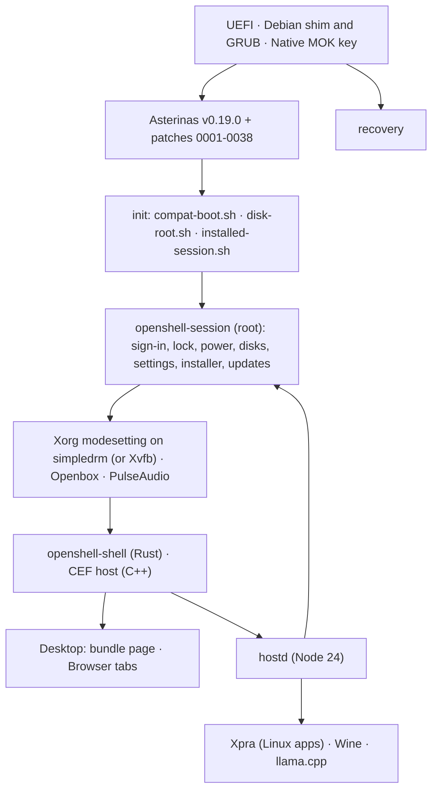

# OpenShell Native — Implementation plan and current status

**Revision 1.3 · November 15, 2026.** Replaces the v0.1 technical proposal of November 11, whose stages 0 to 6 are complete. 1.1 added Wi-Fi above the chip (patches 0039 to 0041); 1.2 added interrupts for networking and sound, the firewall and servers on every address (patches 0042 to 0044), SSH, screen sharing and printing tested in QEMU, the first part of the Intel Wi-Fi driver, off by default (patch 0045), `poll` with the same file twice (patch 0046), the end of two loops that each kept a processor busy (Xorg and hostd, the cause of the Desktop stuck on hardware, patch 0047), UDP on every address, IPv4 multicast and ARP that holds packets while it asks (patch 0048), and FUSE, with NTFS through ntfs-3g (patch 0049). 1.3 brings the Wi-Fi drivers of the four main vendors on a LinuxKPI layer (patch 0057): Intel as a radio, on by default, from the 7000, 8000 and 9000 families to the AX ones (0058), MediaTek MT7921/7922 (0059), Realtek RTL8821CE, RTL8822BE and RTL8822CE (0060) and Qualcomm QCA6174/QCA9377 (0061), not yet tested on a real card; later in the same revision, the Intel BE200 (MLD API), the MediaTek MT7925, 40 MHz and wider channels with VHT and HE, access point mode with the hotspot (NAT and DHCP in the kernel, patch 0062), Realtek rtw89 with the RTL8922AE (0063), Qualcomm ath11k (0064) and Broadcom FullMAC (0065).

OpenShell Native is the installable edition of OpenShell with a Rust kernel and Linux binary compatibility. Its base is Asterinas v0.19.0, kept as a traceable upstream with a patch series. The system runs the same OpenShell Desktop bundle as OpenShell Live (Debian), in a CEF shell instead of Electron ([CEF plan](ARCHITECTURE-CEF.md)), with its own supervisor, installer, A/B updates and recovery. OpenShell Live remains an independent Debian edition and the behavioural control: every Native feature is measured against what Live does.

## 1. Architecture

| Layer | Where it lives | What it does |
| --- | --- | --- |
| Kernel | [kernel/patches](kernel/patches/README.md), revision in [kernel/config/upstream.lock.json](kernel/config/upstream.lock.json) | The ABI that Chromium, Node, Python, Xorg, Xpra and Wine use, with Chromium's sandbox in effect; PC drivers (section 3). Each patch records its workload, test and upstream status. |
| Composition | [userspace/compatibility/initramfs.nix](userspace/compatibility/initramfs.nix) | The system's Nix closure from Asterinas's pinned nixpkgs: Node, Python, Xorg, Mesa, CEF, PulseAudio, Xpra, Wine, llama.cpp, fonts. The same binaries for the ISO, the installed image and the tests. |
| Init and boot | `userspace/compatibility/probes/*.sh`, [distro/image](distro/image) | Boot of the live media and of the installed system, copying the system to the data partition, mounting `data`, slot trial and confirmation. |
| Supervisor and shell | [userspace/shell](userspace/shell) | `openshell-session` (root) answers the session over sockets with peer credentials: password, lock, power, disks, settings, installer, updates. `openshell-shell` starts `hostd` and the CEF host; the navigation policy is the Rust library the CEF host consults. |
| A/B | [distro/ab](distro/ab) | Redundant selector, signed manifest (Ed25519), staging of the inactive slot, trial with a counter, confirmation and recovery. |
| Desktop | `openshell` repository, `apps/desktop` | The bundle is the same as Live's. On Native, `src/host/native*.ts` implements the interface of Electron's main process over the shell's bridge, and `hostd/native/*` adapts the services that on Live depend on Debian (systemd, udisks, NetworkManager, journald). |

## 2. Repositories and build

| Repository | Responsibility |
| --- | --- |
| `openshell` | Desktop, `hostd`, the `@openshell/host-api` contract, shared UI. Exports the Linux bundle (`pnpm desktop:bundle`). |
| `openshelllive` | The Debian ISO of OpenShell Live: control and independent edition. |
| `openshell-native` | Kernel patches, composition, supervisor and shell, images, A/B, recovery and system tests. Consumes the Desktop bundle. |

The build runs in a Linux container (Docker; on Windows, Docker Desktop in Linux mode) with the pinned official Asterinas image. The patch series applies from scratch on every build, checked with `git diff --check`, and the tests run in QEMU with OVMF and TCG. The actions of [tools/build/native.mjs](tools/build/native.mjs) and the [README](README.md#development-probes-and-builds) list the commands; `make iso` and `make install-image` produce the media.

## 3. Status by area

Results in QEMU unless stated otherwise, and in the ongoing hardware pilot. The [README](README.md#parity-with-openshell-live) compares each feature with Live.

| Area | Status | Gaps |
| --- | --- | --- |
| Boot and Secure Boot | Debian's shim and GRUB, the kernel signed with the Native key enrolled once in MokManager; the stick's menu is Live's (Live, install, update keeping files, more options), with the same theme; loading screen until the Desktop. | A custom UEFI loader is out of scope: GRUB covers slot selection and recovery. |
| ABI and sandbox | Chromium with seccomp-bpf and user, PID and network namespaces; Node, Python, Xorg, Xpra and Wine. | `ip route add` (netlink `RTM_NEWROUTE`), journald and systemd services. |
| Display and input | Xorg on DRM (simpledrm) with software Mesa; PS/2 and USB keyboards, Synaptics and ELAN touchpads, USB mice, hubs; Intel brightness. | GPU acceleration, dual monitors, I2C-HID touchpads, AMD brightness, IME. |
| Storage | VirtIO, NVMe, SATA (AHCI, patch 0037) and USB (Bulk-Only); ext2, exFAT and FAT12/16/32; NTFS through ntfs-3g and any FUSE filesystem (`/dev/fuse`, patch 0049); `/sys/block`, `/proc/partitions`, `/proc/diskstats`; mounting from the Desktop. | UAS, NCQ, optical drives. |
| Network | VirtIO, Intel e1000/e1000e/igb/igc, Realtek RTL8111/8168/8125, USB tethering (ECM, NCM, RNDIS); DHCP in the kernel, routes through netlink, `/proc/net/{route,dev,pnp}`; `AF_PACKET` sockets; TCP and UDP servers on `0.0.0.0` (patches 0044 and 0048), IPv4 multicast with `IP_PKTINFO` (patch 0048); dual-stack IPv6 TCP sockets on top of IPv4 (`[::]`, `::1`, mapped addresses, `IPV6_V6ONLY`, patch 0051); stateful inbound firewall in `/proc/net/firewall` (patch 0043). Wi-Fi above the chip: nl80211 over generic netlink, unmodified `wpa_supplicant`, session requests through the supervisor, the Network page (tested with the simulated radio `wlan.sim`); Wi-Fi drivers with WPA2, at 40/80/160 MHz with HT, VHT and HE (20 MHz on the Intel 7000 to 9000), 6 GHz where the chip has it, EHT on the BE200, MT7925 and RTL8922AE, block ack and power saving, host calibration of the Realtek 802.11ax chips, on the LinuxKPI layer (patch 0057): Intel 7260 to AX411 and BE200 (patches 0045 and 0058), MediaTek MT7921/7922/7920/7925 and the USB adapters MT7921AU/MT7925U (0059), Realtek RTL8821CE/8822BE/8822CE/8723DE and their USB adapters (0060) and RTL8852AE/BE/BTE/CE, RTL8851BE and RTL8922AE, with the USB adapters RTL8851BU/8852AU/8852BU/8852CU (0063), Qualcomm QCA6174/QCA6164/QCA9377 (0061) and QCA6390/WCN6855/QCA2066/QCA6698AQ/QCN9074 (0064), Broadcom FullMAC PCIe (0065); nl80211 access point for hostapd and a hotspot with NAT and DHCP in the kernel (0058, 0062). | The Wi-Fi drivers checked on real cards; MLO, USB adapters with their own chip (ASIX, RTL815x), IPv6 through SLAAC/DHCPv6, servers on `::`, IGMP and IPv6 multicast, outbound firewall rules. |
| Sound | Intel HDA with the generic codec path, ALSA in `/dev/snd`, the session's PulseAudio; volume, microphone and switching to headphones. USB audio (USB Audio 1.0 and 2.0 over xHCI isochronous transfers, patch 0053): headphones, headsets, speakers and sound cards become ALSA cards when plugged in, and PulseAudio switches to them. | HDMI/DisplayPort, per-model quirks, digital microphones (SOF), USB devices with implicit feedback. |
| Session | Password sign-in, lock, shut down and restart, installer, settings (time zone, name, keyboard, brightness), disks, logs, processes and performance; firewall, SSH and Wi-Fi on the session's request, through the supervisor; screen sharing (x11vnc) and printing (CUPS, network printers by address and discovered ones, USB printers through `ipp-usb` and the `usb` backend, with USB devices given to programs as on Linux, patch 0052); Bluetooth through BlueZ (`bluetoothd` on the system D-Bus; in the kernel, `AF_BLUETOOTH` with the management interface, connections, L2CAP channels, SSP and SMP pairing, `/dev/uhid`, btusb and Intel and Realtek firmware, patch 0050): power, name, discoverable, scan, pair, connect, keyboards and mice. | Suspend; Bluetooth audio untested with real headphones; USB isochronous transfers for programs (the kernel already does them for audio and for Bluetooth voice, patches 0053 and 0054). SSH, x11vnc, CUPS (USB printers too) and Bluetooth tested in QEMU, not yet in a full image. |
| Desktop | Desktop, Files, Terminal, Browser with native tabs, Linux (Xpra) and Windows (Wine) apps, local models (llama.cpp b11960 on the CPU), dictation (Whisper) and read-aloud (Piper) in the page, themed tips. | Parity for services that depend on Debian (NetworkManager, udisks, journald) is through adapters, read-only where Native lacks the service. |
| Data and updates | GPT image with `system_a`, `system_b`, `recovery` and `data`; installation on NVMe, SATA, USB or VirtIO, from the live Desktop or from the stick's menu entry; signed update of the inactive slot from the release channel or from the stick (keeping files, with a way back to the previous release); 3-boot trial and rollback. | Disk encryption, snapshots. |

## 4. Roadmap

| Stage | Status | Evidence |
| --- | --- | --- |
| 0 · Inventory and baseline | Complete | Upstream lock, bundle and control probes on Linux. |
| 1 · Kernel in QEMU | Complete | Repeated boots with console, disk and network. |
| 2 · Compatible userspace | Complete | Node, Python, PTY, VFS, inotify, DNS/TLS and IPC probes passed (README, *Compatibility status*). |
| 3 · Graphics and browser | Complete, with CEF instead of Electron | `cef-smoke` (window, input, Worker, isolation) with the sandbox in effect. |
| 4 · Integrated Desktop | Complete | `shell-smoke`, `hostd-smoke`, `host-api` contract tests. |
| 5 · Supervisor and session | Complete | `session-smoke`, password sign-in and lock, recovered restarts. |
| 6 · Image and recovery | Complete | A/B image with update, trial, rollback and recovery on VirtIO and NVMe (`boot-test.sh`, which gained the SATA case in this revision, still to run); live installer; Live's stick menu and updating from the stick (`update-test.sh`). |
| 7 · Reference hardware | In progress | First tests on a physical laptop. PC drivers added from patch 0027 on (keyboard, brightness, USB, network, sound, SATA): each still has to be checked on real machines. |
| 8 · Wireless connectivity | Planned | Needs each machine's chip (`lspci -nn`, `lsusb` on Live) and the firmware from linux-firmware. |
| 9 · Peripherals and services | In progress | Kernel firewall (patch 0043), SSH, screen sharing and printing, tested in QEMU. Suspend and GPU acceleration are missing. |

### Next steps, in order

1. **Check on hardware what already passes in QEMU.** Installation and boot on a SATA disk; the stick's menu (Live, Install, Update, More options) and updating an installed system from it, after making the stick with the release key; Intel I219, I211/I225 and Realtek RTL8111/8125 Ethernet (not emulated in QEMU); sound on Realtek, Conexant and Cirrus codecs; USB headphones or a headset (the kernel log says `sound card N: <product> (USB Audio 1.0/2.0)` and PulseAudio switches to it); USB tethering from phones; local models with a GGUF from the catalogue in the image.
2. **Wi-Fi chip drivers, each checked on hardware.** The common part is ready (the `aster-wlan` component, patches 0039 to 0041): a driver only implements the `radio::Radio` operations. Intel first, being the most common: firmware -77 speaks the same command set on the AX200, AX201, AX210 and AX211, which therefore come from a single driver. What the drivers translated from Linux have in common (bits, waits, PCI, MSI-X, DMA, firmware) is a LinuxKPI layer (`aster-linuxkpi`, patch 0057). Written (each still to be checked on a real card, reading in the kernel log how far it gets): Intel (`aster-iwlwifi`, patches 0045 and 0058: second-generation PCIe transport for the AX and BZ chips (BE200, through the firmware's MLD API) and first-generation for the 9000, 8000 and 7000 families, with the calibration program, the host queues and the driver's rate control; `alive`, the start commands, UMAC scanning, association, keys and data), MediaTek MT7921/7922/7920 and MT7925, also on the USB adapters MT7921AU and MT7925U (`aster-mt7921`, patch 0059), Realtek RTL8821CE, RTL8822BE, RTL8822CE and RTL8723DE, also on USB adapters, and the USB adapters RTL8812AU and RTL8821AU (`aster-rtw88`, patch 0060, with the kernel's USB driver interface in `aster-usb`) and the rtw89 ones, RTL8852AE/BE/BTE/CE, RTL8851BE and the next-generation RTL8922AE, with the USB adapters RTL8851BU, RTL8852AU, RTL8852BU and RTL8852CU (`aster-rtw89`, patch 0063), Qualcomm QCA6174/QCA9377 (`aster-ath10k`, patch 0061) and the ath11k chips, with their own MHI, QRTR and QMI (`aster-ath11k`, patch 0064), and Broadcom FullMAC (`aster-brcmfmac`, patch 0065). 40/80/160 MHz with VHT and HE (the Intel 7000 to 9000 up to 80 MHz); access point (hotspot), block ack, power saving and 802.11w on all of them; group TKIP on Realtek, MediaTek and Qualcomm; 6 GHz where the chip has it and EHT on the BE200, the MT7925 and the RTL8922AE; the Realtek 802.11ax chips calibrated by the host (`rtw8852*_rfk`, `rtw8851b_rfk`). Then: checking on real cards, MLO.
3. **Bluetooth on hardware.** Patch 0050 brings the whole of Bluetooth up to pairing (the `aster-bluetooth` component: HCI core, the management interface in its own task, ACL and LE connections, SCO and eSCO links, L2CAP and RFCOMM channels, SSP, SMP with LE Secure Connections and legacy pairing, HCI, L2CAP, RFCOMM and SCO sockets, `/dev/vhci`, `/dev/uhid`, `/dev/rfkill`, btusb, Intel and Realtek firmware, `AF_ALG`), tested in QEMU with BlueZ on both sides and with BlueZ's kernel test suites. **First hardware test**: the kernel log (`Bluetooth: hci0` lines) says whether the firmware loaded; the Bluetooth page should list nearby devices, pair a mouse or keyboard and have it work; then headphones (A2DP through PulseAudio). Call voice through USB adapters (SCO over isochronous transfers, patch 0054) passes in QEMU; on hardware, a call with a headset (the kernel log says `hci0: voice ...: setting N`). The MediaTek, Qualcomm and Broadcom chips and the PCIe Intel ones are missing.
4. **Check the new services in an image and on hardware.** SSH, screen sharing and printing pass in QEMU (each with the real program and outside clients); booting a full image and a real printer are missing. Network printer discovery (Avahi, system D-Bus, nss-mdns; kernel in patch 0048) and USB printers (`ipp-usb` and CUPS's `usb` backend over the usbfs of patch 0052) pass in QEMU with simulated printers; a real printer, network and USB, is missing. Servers on `::` come up since patch 0051 (dual-stack IPv6 on top of IPv4).
5. **Performance.** Network cards and sound already signal by interrupt (MSI, patch 0042), with the timer as a fallback until the first one arrives: check on hardware with `/proc/interrupts`. Then NCQ on SATA and IPv6 through SLAAC.

## 5. Security and robustness

The kernel does not use `unsafe` in the added components (`#![deny(unsafe_code)]`), and what comes from outside is bounded before use. The review of 11/13/2026 checked the inputs that a device, the network or a program controls and fixed:

- **Sound (patch 0038).** The controls programs create are limited to 32 per card, like Linux's `MAX_USER_CONTROLS`; the ioctls' pointers go through checked arithmetic (`EFAULT`).
- **DHCP (patch 0038).** The domain the server sends only goes into `resolv.conf` (`/proc/net/pnp`) if it is a name; before, a line break added lines and a non-text byte emptied the whole file.
- **Updates.** The members of the release archive must come out as regular files, never links, before `openshell-ab` checks the signature.
- **Installation.** The installer accepts whole SATA and USB disks, but never the live media the system booted from (ISO 9660 volume `OPENSHELL_NATIVE`). With the media's signed manifest, it checks what the computer read from the stick before writing.
- **Updating from the stick.** The media's release only enters an installed system after `openshell-ab update-offline` checks the manifest's signature and every file written; the slot in use is never touched, and the new version runs on trial, with a way back to the previous one.

Already checked and unchanged: FAT (boot sector validated, chains outside the volume treated as broken, cycles limited to the number of clusters), USB network frames (NCM tables bounded, slices via `get`), the lengths network cards write (bounded by the buffer), the supervisor's socket (session user only, requests bounded and with a timeout), mounts (root's folder, `nosuid,nodev`, sanitised label) and settings (time zone without `..`, keyboard without extra lines, name without `passwd` separators).

## 6. Decisions

| Decision | Status |
| --- | --- |
| Asterinas as the base | Adopted: the ABI and the sandbox are enough for the Desktop, Linux apps and Wine. |
| CEF instead of Electron | Adopted ([CEF plan](ARCHITECTURE-CEF.md)): Linux Electron remains the behavioural reference on Live. |
| Composition through Asterinas's nixpkgs | Adopted: a single closure for the ISO, the image and the tests, with the packages Live has in close versions. |
| Boot through Debian's shim and GRUB | Adopted: Secure Boot without a custom loader; GRUB reads the data partition's `grubenv` for the trial. |
| Data filesystem | ext2 adopted for the slots and the data partition; journaling, snapshots and encryption are under evaluation. |
| Drivers in the kernel, one per family | Adopted: each family (HDA, e1000, igb, r8169, xHCI, AHCI) in its own component with MSI and polling as a fallback, tested in QEMU where emulation exists and on the pilot hardware where it does not. |
| `hostd` in Rust | Conditional on the `host-api` contract tests, method by method. |
