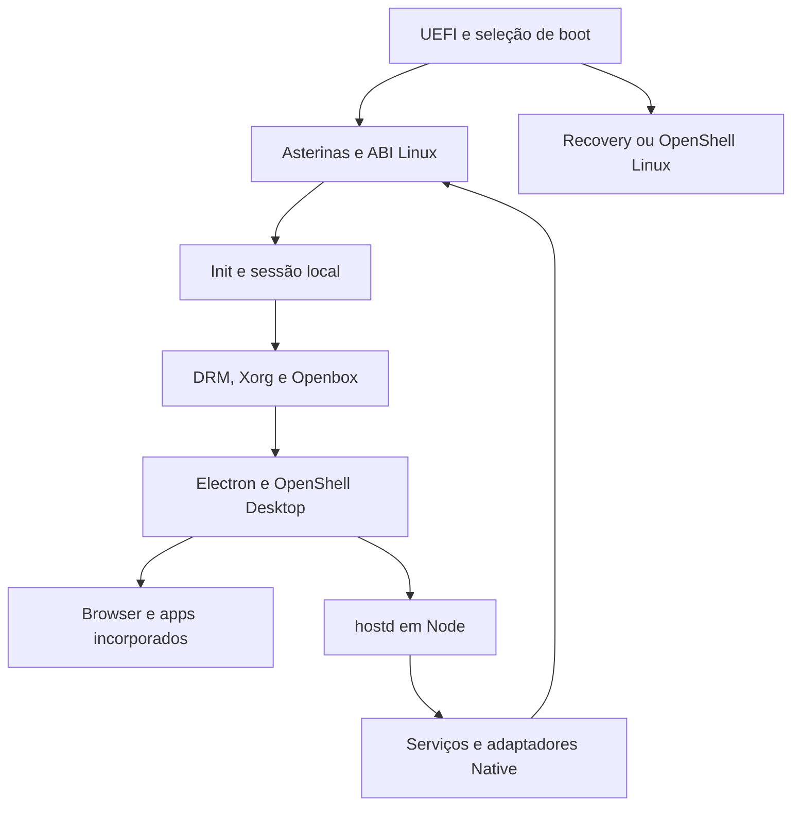

# OpenShell Native — Plano de implementação

**Proposta técnica v0.1 · 11 de novembro de 2026**

OpenShell Native é uma edição instalável do OpenShell com kernel em Rust e compatibilidade binária Linux progressiva. A base proposta é o Asterinas, mantido como upstream rastreável. O objetivo é substituir o kernel Linux e, por etapas, os serviços de sistema hoje fornecidos pelo Debian Trixie, preservando a interface, os apps, os agentes, as ferramentas e os dados do OpenShell. O OpenShell Live continua como edição Debian independente e como opção de retorno durante a migração.

O primeiro marco técnico é rodar **o Electron do OpenShell Desktop, com sandbox ativo, sobre Asterinas x86-64 no QEMU**, com um hostd real e um Browser integrado. O primeiro marco de produto vem depois e exige persistência, autenticação, recuperação e instalação demonstradas. Este plano deriva de *OpenShell Native — Arquitetura de kernel Rust com compatibilidade Linux* e da inspeção dos dois repositórios atuais. Os critérios abaixo são metas de validação.

## 1. Sistema atual e pontos de acoplamento

| Responsabilidade | Implementação encontrada | Consequência para Native |
| --- | --- | --- |
| Mídia, boot e instalação | `openshelllive` gera ISO Debian 13 com live-build, GRUB/shim em UEFI, initramfs e SquashFS. O instalador atual usa Calamares. | Produzir imagem Native separada. Reaproveitar fluxos e testes de UX e seleção de disco. |
| Sessão gráfica | `openshell-session@.service` usa systemd, PAM/logind e tty1. `session.sh` e `xsession.sh` iniciam X e Openbox. A instalação exige autenticação nativa antes de abrir o kiosk. | Preservar inicialização automática do kiosk. Em modo instalado, manter o bloqueio e a autenticação antes de expor dados e hostd. |
| Desktop | `apps/desktop` compila a interface web com overrides Vite. O processo principal Electron inicia o hostd e recebe a URL local. `package.json` fixa Electron 44.5.1 no checkout inspecionado. | Fixar o Electron correspondente ao bundle avaliado. O shell e o Browser precisam ser testados dentro do mesmo processo principal e dos mesmos preloads. |
| Browser e apps Linux | Browser usa `<webview>` do Electron, com navegação, popups e downloads mediados. Apps gráficos Linux usam Xpra, com displays e integração próprios. | Chromium simples serve para diagnóstico. Paridade do Browser exige Electron. Xpra e o catálogo de apps Linux têm validação própria. |
| Ponte local | `apps/desktop/hostd` usa Node, HTTP e WebSocket com enquadramento binário no loopback. `packages/host-api` define o contrato e a versão. O Desktop adapta a API de arquivos do browser para o disco real. | Portar o hostd existente e testar o protocolo real. Introduzir adaptadores nas implementações que dependem dos serviços Debian. |
| Armazenamento e execução | O hostd fornece `fs`, `fsWatch`, `memory`, `pty`, `exec`, `shares`, `snapshots` e `updates`. O Desktop usa também perfil Electron e runtime nativo llama.cpp. | Inventariar layouts físicos, formatos, módulos nativos, permissões e consumidores antes de definir migração ou anunciar compatibilidade. |
| Atualização | O Live tem assistente USB e sincronização dos componentes Debian. A atualização do Desktop faz staging e troca atômica de `/opt/openshell`. | Reaproveitar revisão, progresso e recuperação na interface. O updater Native publica uma unidade de boot composta por kernel, initramfs e sistema. |

Os pontos de partida locais são `openshell/apps/desktop/{README.md,NATIVE.md,vite.config.ts,electron/main.ts,hostd/server.ts}`, `openshell/packages/host-api/src/{methods,protocol}.ts`, `openshell/packages/memory`, `openshelllive/docs/{ARCHITECTURE,UPDATES,STATUS}.md` e `openshelllive/live/config/includes.chroot`.

## 2. Arquitetura e divisão dos repositórios

O kernel fornece processos, memória virtual, ABI de syscalls e dispositivos. O userspace fornece libc, bibliotecas, init, serviços, sessões e UI. A ABI Linux permite executar os binários validados diretamente sobre o kernel Rust. A interface usada por Sessions, Files e Tools continua no hostd e no contrato `@openshell/host-api`; nenhum detalhe de syscall deve entrar na UI.

| Repositório | Responsabilidade |
| --- | --- |
| `openshell` | Código-fonte do Desktop, Electron, hostd, contrato, UI compartilhada, runtimes e smokes de produto. Exporta o bundle Linux amd64 com build ID e checksums. |
| `openshelllive` | ISO Debian, instalação e atualização atuais. Fornece a imagem de referência e o fallback independente para pilotos. |
| `openshell-native` | Integração do kernel, boot, rootfs, imagens, recovery, adaptadores e testes de sistema. Consome bundles versionados do Desktop. |

Diretórios previstos, a serem criados conforme cada etapa tiver código ou configuração:

| Diretório | Conteúdo |
| --- | --- |
| `kernel/{upstream,patches,config}` | Revisão upstream fixada, série de patches e perfis de build. |
| `boot/{uefi,boot-config}` | Seleção de release, parâmetros do kernel e, na fase de imagem instalável, carregador UEFI em Rust. |
| `userspace/{init,supervisor,device-manager,session-manager,compatibility}` | Init de diagnóstico, supervisor posterior, integração de sessão/dispositivos e perfis de compatibilidade. |
| `graphics/{kiosk,compositor}` | Configuração de Xorg/Openbox e do kiosk. `compositor` fica reservado para uma decisão posterior. |
| `openshell/{runtime,integration,packages}` | Receitas de empacotamento, serviços de sessão e adaptadores usados pelo bundle do Desktop. |
| `distro/{rootfs,installer,updater,recovery}` | Montagem de imagens e operações de instalação, atualização e recuperação. |
| `tests/{syscall,graphics,integration,e2e}`, `tools/{build,qemu}` | Provas de ABI, testes de sistema e execução reproduzível. |

### Base upstream e build

Usar `v0.19.0` do Asterinas como baseline inicial, resolvendo a tag para o SHA completo. A release demonstra DRM/KMS, buffers GEM e Xorg com Mesa em software no Asterinas NixOS. A capacidade de executar o Electron, as bibliotecas do OpenShell, a política de sandbox e os drivers físicos continua sendo uma questão experimental. [Release Asterinas v0.19.0](https://github.com/asterinas/asterinas/releases/tag/v0.19.0) · [Anúncio técnico](https://asterinas.github.io/2026/10/13/announcing-asterinas-0.19.0.html)

Fixar revisão, versão de Rust e OSDK, imagem do builder por digest, QEMU, OVMF, CPU virtual e lista de dispositivos, receita do rootfs, catálogo de pacotes, Desktop build ID e checksums de Electron/Node. Usar host Linux para builds de referência, com runner KVM para o desktop. WSL2 ou contêiner Linux é opção de desenvolvimento no Windows, e TCG serve para testes rápidos e reprodução portátil. O perfil QEMU deve declarar firmware, controlador, backend de vídeo, input, disco, rede e serial. Para o primeiro boot, copiar a configuração do upstream fixado antes de variar dispositivos. [Guia do OSDK](https://asterinas.github.io/book/osdk/guide/index.html) · [Desenvolvimento com Nix](https://asterinas.github.io/book/kernel/nix-development.html)

A série de patches deve aplicar do zero no CI. Cada patch registra o workload que exige a mudança, seu teste e a situação upstream. Ao atualizar a base, comparar upstream limpo, revisão anterior e nova série no mesmo conjunto de testes. Nas mudanças de baixo nível, registrar invariantes de propriedade de memória, DMA, interrupções e sincronização nas fronteiras `unsafe`. Antes de distribuir uma imagem, gerar SBOM, avisos e fonte correspondente dos arquivos cobertos pela MPL-2.0 e revisar as licenças dos demais componentes distribuídos. [Asterinas](https://github.com/asterinas/asterinas) · [MPL 2.0](https://www.mozilla.org/en-US/MPL/2.0/)

## 3. Boot, init e composição do sistema

| Perfil | Conteúdo | Objetivo |
| --- | --- | --- |
| Referência upstream | Imagem Asterinas/NixOS, boot e init suportados pela revisão escolhida. | Reproduzir shell e gráfico upstream e obter um controle para investigar regressões. |
| Diagnóstico CLI | Initramfs mínimo com init ou harness de teste, BusyBox, probes estáticas e console serial. Rootfs de teste separado, inicialmente descartável. | Isolar execução, disco e VFS. Acrescentar binários dinâmicos com suas bibliotecas e provar Node, Python e a libc usada pelo bundle. |
| Kiosk | Base de userspace do upstream com closure coerente de bibliotecas, sessão X e bundle real. Manter o init funcional da base. | Reproduzir o desktop, identificar os serviços que faltam e validar o sandbox antes de congelar a composição Native. |
| Native instalável | Rootfs declarativo e imutável por release, configuração de sessão, volumes persistentes e recovery independente. | Entregar atualização e rollback testáveis. |

Inventariar `PT_INTERP`, `DT_NEEDED`, versões de símbolos GLIBC/GLIBCXX, módulos Node, executáveis auxiliares, fontes, locale, certificados, MIME e dependências carregadas dinamicamente. Criar uma closure coerente de bibliotecas por perfil e verificar resolução de loader, RPATH e carregamentos opcionais durante o boot de teste. O build pode reaproveitar bibliotecas e pacotes Linux em userspace mesmo após trocar o kernel. A composição final do rootfs depende do resultado do kiosk.

No primeiro boot, capturar console serial do firmware disponível até o login de diagnóstico e registrar marcadores para entrada do kernel, root montado, init e shell. Em seguida validar relógio, SMP, interrupções, PCI e VirtIO conforme o perfil upstream, com leitura e escrita em disco de teste, link de rede e entropia antes de DNS/TLS. QEMU/OVMF UEFI é o alvo da distribuição e pode ser validado em paralelo ao boot upstream. O perfil inicial usa o mecanismo upstream; o carregador próprio entra após a prova do kiosk.

O carregador Rust futuro deve selecionar entradas por identificador estável, verificar manifestos e artefatos, e entregar kernel/initramfs pelo protocolo confirmado na revisão do Asterinas. Preferir encadear um executável EFI que implemente esse protocolo se disponível e validado. Se o carregador assumir a transição diretamente, obter o mapa final de memória e seu `MapKey`, tratar a repetição exigida quando o mapa muda, encerrar Boot Services no ponto definido e entregar ao kernel apenas buffers reservados e descritores válidos. Validar GOP/ACPI somente se fizerem parte do handoff escolhido. Testar seleção do slot, degradação para recovery e preservação da entrada Debian. [UEFI Boot Services](https://uefi.org/specs/UEFI/2.10/07_Services_Boot_Services.html)

O supervisor Rust começa como serviço do init existente. Ele acompanha prontidão de sessão X, hostd autenticado e renderer, recolhe processos filhos, encerra grupos de processos ordenadamente, aplica backoff com limite e conserva logs por boot. O processo principal Electron permanece como dono do hostd na primeira integração. Uma futura mudança de supervisão exige um único dono por processo e uma migração do fluxo `OPENSHELL_HOSTD_READY`. PID 1 próprio só entra após comprovar montagem inicial, tratamento de sinais, reaping de órfãos, desligamento e recuperação equivalentes.

## 4. Compatibilidade Linux por workload

A unidade de compatibilidade é um workload com binário, versão, arquitetura, dependências, operações observadas e testes. Uma syscall disponível ainda pode divergir em flags, valores de retorno, estruturas, ordem de eventos ou cancelamento. A primeira lista vem de uma execução limpa no OpenShell Live com os mesmos binários que serão usados no Native.

| Área | Superfície a provar | Teste de aceitação |
| --- | --- | --- |
| ELF e memória | ELF64 dinâmico, TLS, threads, auxv, `mmap`, `mprotect`, `mremap`, `memfd_create`, memória compartilhada e `/dev/shm`. | Binários estático e dinâmico, Node e Python iniciam. Worker e renderer do Electron sobrevivem a ciclos de alocação, proteção e liberação. |
| Processos e terminal | `execve`, `clone`/variantes usadas, `wait`, sinais, grupos e sessão, `/dev/ptmx`, `devpts`, ioctls de TTY. | Shell interativo, pipeline, job control, Ctrl+C, resize, comando cancelado e subprocessos recolhidos após encerrar o terminal. |
| IPC e assincronismo | Sockets Unix, credenciais, `SCM_RIGHTS`, `epoll`, `eventfd`, `timerfd`, `futex`, `/proc` e sockets do display. | Node/hostd real responde a RPC, PTY e streaming concorrentes. Renderer, workers e subprocessos atravessam ciclos de restart. |
| VFS e watchers | `statx`, resolução de caminhos, permissões, symlinks, `rename`, `fsync`, `inotify` e overflow. | Files e Memory convergem após criação, rename atômico, edição, exclusão e rajada de eventos. Reindexação recupera eventos perdidos. |
| Rede e relógio | Loopback, TCP, UDP, DNS, IPv4/IPv6 conforme configuração, entropia, relógios monotônico e civil. | DNS e TLS contra fixtures, SSE com cancelamento, perda/retorno de conectividade e separação entre prontidão local e rede externa. |
| Sandbox e credenciais | UID/GID, capabilities, `prctl`, `seccomp`, namespaces e interações com `/proc` exigidas pelo Electron fixado. | Shell e webviews funcionam com a configuração de sandbox exigida, comprovada por diagnóstico e testes de isolamento. |
| Gráficos, input e som | Nós DRM, ioctls KMS, eventos de flip, buffers mapeados, XInput, dispositivos de input e interfaces de áudio disponíveis. | Resolução e desenho corretos, teclado e mouse, input no webview, WebGL de referência e áudio em saída suportada. |

No Debian, registrar uma inicialização completa e uma execução funcional com `strace -ff` e, quando necessário, traces focados por processo. Guardar versão, cenário e erros esperados. Como o tracing pode afetar a ativação do sandbox, coletar também uma execução independente, sem tracer, para validar a configuração real. Repetir probes idênticos no Native, comparar resultados e registrar o primeiro desvio com um teste mínimo. Usar os casos pertinentes do LTP e os testes do upstream como complemento. [Linux Test Project](https://linux-test-project.readthedocs.io/en/latest/) · [Sandbox Linux do Chromium](https://chromium.googlesource.com/chromium/src/+/HEAD/sandbox/linux/README.md)

Manter uma matriz versionada com workload, build testado, versão do kernel, perfil, status, falha mínima e artefato de evidência. Para cada lacuna, escolher correção upstream, adaptação de userspace ou restrição explícita do perfil. Nos casos de fallback legítimo de libc, reproduzir o resultado Linux esperado, inclusive o `errno` que aciona o fallback. Nas operações de segurança, sucesso exige que a operação tenha sido efetivamente aplicada.

Os perfis de apps propostos são **CLI** para BusyBox, shell, Python e binários validados, **Desktop** para Electron/hostd e **Apps Linux** para uma lista explícita de binários gráficos testados com Xpra. A primeira edição cobre Linux ELF x86-64 validado e bibliotecas correspondentes. Módulos de kernel Linux, executáveis de outra arquitetura, Docker e compatibilidade geral com pacotes Debian ficam para fases próprias.

## 5. Prova gráfica e integração do Desktop

1. Reproduzir o Xorg upstream com o mesmo dispositivo virtual. Testar `/dev/dri`, modos, apresentação de buffers, teclado e mouse. Confirmar o renderer de software com uma sonda GL e conservar os logs Xorg/Mesa.
2. Iniciar Chromium headless em fixture local, se ajudar a isolar o runtime. Em seguida rodar Electron com uma janela local, subprocessos normais, perfil descartável e o sandbox habilitado. Confirmar o comportamento do renderer e de um guest separado.
3. Iniciar o bundle real e Openbox em sessão de usuário. Exercitar o fluxo Electron → hostd → URL local → preload → renderer. Usar o mesmo endereço/origem do perfil de teste em reinicializações e verificar que dados persistidos continuam acessíveis.
4. Abrir uma fixture no Browser integrado e validar navegação, permissões do guest, clipboard, download, popups e um worker real. Testar Monaco, WASM e uma cena Three.js/WebGL, registrar o backend efetivo e medir tempo até o desktop utilizável, RAM, CPU e fluidez. O backend de OpenGL do Xorg e a escolha de ANGLE/SwiftShader do Electron precisam de evidências independentes.
5. Só depois ampliar para PipeWire/PulseAudio, Xpra, múltiplas saídas, monitoramento de rede e demais integrações. Para múltiplas saídas, reutilizar `smoke-display-fullscreen.cjs` e testar fullscreen, input no outro monitor, reposicionamento e hotplug real ou em perfil com duas saídas.

A prova de desktop usa usuário sem privilégios, separação de contextos, Node desabilitado no renderer e nos guests, sandbox efetivo nos processos exigidos e política de acesso do hostd. Um teste negativo deve confirmar que uma página aberta no Browser e um guest de custom app não conseguem usar RPCs privilegiados. Testar também reinicialização do hostd, cookies/origens, IPC dos preloads e origem da janela que pede uma operação. Tratar falha de sandbox como bloqueio para navegação externa, integração de dados reais e promoção de release. [Process sandboxing do Electron](https://www.electronjs.org/docs/latest/tutorial/sandbox) · [Segurança e IPC no Electron](https://www.electronjs.org/docs/latest/tutorial/security)

### Adaptadores e paridade funcional

Começar rodando o hostd atual. Fazer alterações nos serviços conforme surgirem dependências concretas de `nmcli`, `pactl`, `udisksctl`, `systemctl`, `xrandr`, polkit ou helpers Debian. Manter nomes de métodos, payloads, eventos, cancelamento, erros e contratos de streaming existentes. A negociação começa no handshake já presente. Se o contrato precisar informar capacidades granulares, adicionar campos compatíveis e testar um renderer anterior. Operações indisponíveis devem usar a resposta prevista pelo contrato, com motivo legível na UI.

| Área | Primeira integração | Evidência para avançar |
| --- | --- | --- |
| Sessions, Agents e Tools | Reutilizar frontend, QuickJS e execução via APIs existentes. Usar fixtures locais para provedores e credenciais de teste. | Streaming, cancelamento, ciclo de tools, anexos, persistência de sessão e acesso negado fora das capacidades. |
| Files e Memory | VFS real e eventos do hostd, com caminhos virtuais atuais e reconciliação do índice após perda de eventos. | Importar, editar, mover, apagar e buscar; índice consistente após restart e overflow, com tags preservadas. |
| Terminal, Coder e Python | PTY real e shell Linux. Inventariar separadamente execução Python nativa e o runtime web já empacotado. | Resize, sinais, CWD, pipeline, execução offline e sessão interativa. |
| Browser e apps Linux | Electron para Browser; Xpra e catálogo de apps como trilha posterior. | Browser com guest isolado. Um app GTK/Qt real passa por descoberta, launch, input e encerramento antes de ampliar a lista. |
| Modelos locais | Validar `llama-server` de CPU com um GGUF pequeno e reusar smoke de Desktop. | Streaming, tool calls e cancelamento. Aceleração GPU requer driver e validação separados. |
| Hardware e Settings | Expor recursos disponíveis para o perfil. Começar por rede virtual e display único. | Controles correspondem ao dispositivo real; áudio, múltiplos displays, Wi-Fi, Bluetooth e energia têm resultados próprios. |
| Shares e snapshots | Validar VirtIO-FS como compartilhamento host/VM. Definir separadamente compartilhamentos de rede e a estratégia para snapshots de dados. | Limites e eventos de montagem corretos. SMB/GVfs e Snapper/Btrfs exigem testes próprios antes de prometer paridade. |

Operações de disco, energia e update devem usar serviços com escopo estreito e autorização explícita da sessão. Guardar token/cookies e segredos fora de logs e dumps. Preservar separação entre comandos que o usuário executa voluntariamente no Terminal e capacidades concedidas a guests, agentes ou tools. Para o modo instalado, validar a autenticação nativa e a recuperação da sessão antes de iniciar Electron e hostd.

## 6. Dados, instalação, atualização e recuperação

### Discos e perfis

| Área | Identidade e conteúdo | Política |
| --- | --- | --- |
| ESP | Entrada Native e artefatos EFI necessários ao boot. | Preservar carregadores existentes. Manter a entrada Debian selecionável no piloto e testar retorno mesmo com o Native indisponível. |
| `system_a` e `system_b` | GPT/PARTUUID, rootfs imutável e vínculo inequívoco com kernel/initramfs e manifesto da mesma release. | O slot ativo permanece somente leitura. O inativo é o único alvo de staging. |
| `recovery` | Ambiente de reparo independente dos dois slots. | Deve iniciar com os dois slots corrompidos, abrir dados conforme a política e exportar logs ou restaurar uma release verificada. |
| `data` | Home, perfis, workspaces, apps, memória, modelos, preferências e segredos conforme inventário. | Montagem por identificador estável, permissões verificadas e backup/exportação. Cache regenerável tem política de retenção própria. |

O filesystem definitivo é uma decisão de implementação. O candidato precisa demonstrar flush, `fsync`, durabilidade de rename, recuperação depois de desligamento abrupto e ferramentas de reparo utilizáveis no recovery. Tratar Btrfs/Snapper, criptografia de disco e integridade do root em runtime como requisitos a validar separadamente. A capacidade do Debian de montar um volume não comprova a mesma capacidade no Asterinas. O primeiro piloto em QEMU usa imagem descartável e dados sintéticos.

Antes de migrar dados, levantar onde cada item está persistido, incluindo a origem de armazenamento do Electron, credenciais, identidade do usuário, paths do hostd e versão de schemas. Para o primeiro piloto, usar exportação ou cópia offline verificada para `data`, mantendo a instalação de origem disponível. Separar índice de Memory reconstruível de tags e metadados primários. Validar contagem, hashes amostrais, permissões, links e reabertura dos dados com o bundle de destino. Usar fixtures para sessões, preferências, custom tools, arquivos e GGUF. Manter migrações compatíveis com a release anterior enquanto um trial estiver ativo. Quando isso for inviável, preservar uma cópia ou snapshot com recuperação comprovada e promover a migração somente com um plano de retorno verificável. Evitar perfis Electron compartilhados com escrita simultânea entre edições.

### Transação A/B proposta

1. O updater valida assinatura, versão, arquitetura, compatibilidade, tamanho e hashes do manifesto, seja a origem USB ou rede. Exige espaço suficiente e exclusão mútua entre transações. O manifesto vincula kernel, initramfs, rootfs, build ID Desktop e faixa de schema dos dados.
2. Escreve o slot inativo e os artefatos EFI da release em nomes próprios do slot ou da release. Faz flush, relê e verifica, e só então publica a intenção de boot de teste. A entrada conhecida como boa continua utilizável. Para os metadados do seletor, usar registros redundantes com geração e verificação de integridade, ou um mecanismo equivalente cuja atomicidade seja demonstrada no armazenamento escolhido.
3. O bootloader registra a tentativa antes de transferir controle. A release candidata tem um orçamento inicial proposto de três boots. Boot travado exige um novo ciclo de energia ou watchdog habilitado e validado. Quando o orçamento termina, selecionar o último slot confirmado. Recovery assume se não houver slot válido, com Debian como fallback independente quando instalado.
4. O sistema confirma o slot após verificar integridade do boot, montagem de `data`, sessão gráfica, hostd autenticado, renderer e uma operação local de leitura/escrita em área de diagnóstico. A confirmação fica a cargo de um serviço autorizado e associa a evidência ao slot e à release em execução. Usar perfil de diagnóstico isolado para essa prova quando houver bloqueio de login. A rede externa é assíncrona e fica fora da decisão de saúde.
5. A interface registra progresso, boot pendente, resultado ou retorno, com diagnóstico local. O updater retoma ou descarta staging interrompido de forma idempotente. A política de assinatura distingue rollback automático para release previamente aprovada de reinstalação ou downgrade manual. O segundo fluxo exige seleção explícita e respeito à política de versões revogadas.

Validar corte de energia após cada fronteira durável, mídia corrompida, release incompatível, falha no início do kernel, hostd indisponível, dados fora da faixa de schema e interrupção durante a confirmação. Testar recuperação do seletor com um registro inválido e comportamento sem internet. Secure Boot exige uma cadeia de confiança Native testada em firmware real, inclusive assinatura de artefatos, rotação e revogação de chaves. O shim Debian do Live não concede confiança automática aos binários Native. [Modelo de contagem e confirmação de boot](https://github.com/systemd/systemd/blob/main/docs/AUTOMATIC_BOOT_ASSESSMENT.md)

Começar com instalador de imagem para disco virtual separado. Depois, testar disco físico dedicado e, por último, instalação lado a lado. Separar descoberta somente leitura de aplicação do plano. Registrar identidade do disco, validar novamente antes da primeira escrita, preservar ESP e entradas existentes e testar a remoção da instalação Native. A seleção de disco e os fluxos Live/Instalar/Atualizar/Recuperar podem reaproveitar padrões do Live; o backend Native aplica seu próprio layout e suas transações.

## 7. Roadmap e critérios de avanço

| Etapa | Implementação | Evidência exigida |
| --- | --- | --- |
| 0 · Inventário e baseline | Fixar bundle Debian de referência e cenários. Coletar dependências de ELF, sessão, serviços, armazenamento e syscalls por workload. | Build ID do Desktop e ISO, inventário reproduzível, fixture de teste, logs e resultados de smoke Debian. |
| 1 · Kernel no QEMU | Build upstream fixado, console, init, CPU/memória e VirtIO conforme perfil upstream. | Build repetível, dois boots consecutivos documentados, shell, disco e rede de teste com logs serializáveis. |
| 2 · Userspace compatível | BusyBox, libc, Node, Python, PTY, VFS, eventos, DNS/TLS, IPC. | Probes estáticas e dinâmicas com resultados comparados ao Debian. PTY, arquivo durável, eventos e TLS aprovados no perfil definido. |
| 3 · Gráficos e Electron | DRM/KMS, Xorg/Openbox, Mesa por software e Electron com sandbox. | Janela e guest local utilizáveis, input e WebGL verificados. Provas do sandbox aprovadas. Lacunas de driver/ABI com caso mínimo registrado. |
| 4 · Desktop integrado | Bundle real, hostd e testes de Sessions, Files, Terminal, Memory, Tools e Browser. | Workflows ponta a ponta com dados descartáveis, regressões comparadas e métricas de boot, CPU e RAM capturadas. |
| 5 · Supervisor e sessão | Supervisão Rust como serviço do init, backoff, encerramento ordenado, logs e integração de sessão. | Recuperação de falhas isoladas, terminal limpo após restart e autenticação nativa com falha fechada na edição instalada. |
| 6 · Imagem e recuperação | Bootloader UEFI, rootfs imutável, persistência, updater A/B, recovery e instalador experimental. | Atualização online/offline e rollback em VM, incluindo falhas forçadas. Retorno ao Debian validado quando presente. |
| 7 · Hardware de referência | Piloto UEFI em um equipamento escolhido, driver por driver, antes de ampliar o catálogo. | Instalação, recuperação, autenticação, rede, áudio, input e displays anunciados comprovados. Limites publicados por modelo e perfil. |

**Gate antes de empacotar o desktop inteiro.** Se Electron falhar, reduzir ao primeiro erro reproduzível e identificar se a causa está em ABI, rootfs/bibliotecas, gráficos, IPC ou sandbox. Se a correção exigir mudanças centrais no Asterinas, manter o Debian como edição principal enquanto se valida a correção com o upstream. Chromium isolado permite seguir o diagnóstico sem alterar a definição de paridade.

**Gate de piloto proposto.** Na VM de referência, executar 20 cold boots, uma sessão automatizada de 60 minutos com Browser, Terminal, Memory e streaming, e 10 reinícios controlados de sessão. Exigir zero falhas de boot, crashes inesperados, perda de dados e regressões de isolamento nessa bateria. Capturar mediana e p95 de boot até UI pronta e registrar RAM/CPU em repouso e sob carga. Fixar limites de desempenho depois de medir a mesma VM com a imagem Debian de referência. Tratar os números desta bateria como critérios de engenharia, com hardware e cenários registrados.

### CI e diagnóstico

- Por alteração, executar validação de locks, aplicação limpa de patches, build, testes upstream selecionados, smoke de console e probes de ABI afetadas. Usar timeout externo para detectar travamentos e relatórios estruturados para distinguir falha de boot de falha de teste.
- No runner gráfico, testar a mesma fixture nas imagens Linux e Native com CPU, memória, resolução e dispositivo virtual fixados. Guardar build IDs, hashes, serial, logs de Xorg/Mesa, Electron e hostd, resultados de sandbox e imagens de checkpoints. Capturar apenas perfis descartáveis.
- Antes de uma release, executar a bateria A/B e de persistência, testes com perfil anterior, recuperação com os dois slots inválidos e os cenários físicos prometidos. Reaproveitar os testes de protocolo do Desktop, `smoke-electron.mjs`, `smoke-display-fullscreen.cjs`, `smoke-icon-pinch.cjs` e o smoke de modelos nas fases pertinentes.
- Publicar cobertura como matriz de workloads por release e perfil. Vincular cada falha a commit do kernel, configuração QEMU, pacote e comando que a reproduzem. Uma falha conhecida só pode ser tolerada se o recurso ficar explicitamente fora do perfil anunciado.

### Primeiro pacote de implementação

1. Criar o lock de fontes e ferramentas com o SHA upstream completo e o perfil QEMU do upstream. Construir a imagem sem patches e guardar hash, configuração e log serial.
2. Construir a imagem Debian de controle ou fixar um build já conhecido. Registrar comando de kiosk, sessão, bundle e dependências observadas. Usar o mesmo conjunto de binários e fixtures quando entrar na comparação.
3. Definir entradas reproduzíveis de build, boot e smoke CLI. O smoke inicial deve detectar entrada no kernel, sessão de teste, execução de um binário estático e leitura e escrita em disco descartável. Associar a primeira sonda dinâmica à closure de libc selecionada.
4. Reproduzir Xorg upstream em paralelo com o inventário de Electron e registrar o primeiro teste gráfico. O primeiro teste do browser deve usar o binário Electron fixado, usuário sem privilégios e fixture local, com logs do renderer e do sandbox.

O pacote inicial se considera concluído quando outra máquina consegue reproduzir o boot e os smokes com o lock e o perfil publicados. Drivers físicos, troca de PID 1 e instalação no disco real dependem dos marcos posteriores.

## 8. Decisões a fechar com evidência

| Decisão | Prova necessária | Até decidir |
| --- | --- | --- |
| Asterinas como base da edição Native | ABI e sandbox suficientes para Electron e hostd do OpenShell. | Manter a revisão fixa e usar o Debian como controle e edição instalável. |
| Rootfs e origem de pacotes | Closure completa para o kiosk, atualização reproduzível e segurança da cadeia. | Asterinas NixOS como referência e initramfs mínimo para diagnóstico. |
| Boot e autenticação instalável | Handoff validado, UEFI real, cadeia assinada e bloqueio de sessão antes do desktop. | Usar boot upstream em VM e dados sintéticos. |
| Filesystem, snapshots e criptografia | Durabilidade, reparo, recuperação e migração comprovados. | Discos descartáveis e cópias independentes em testes. |
| Hardware inicial e aceleração | Inventário e resultados de vídeo, input, armazenamento, rede e áudio por dispositivo. | x86-64 virtualizado, renderização por software e uma saída gráfica. |
| Compatibilidade de apps Linux | Catálogo de binários fixados com execução gráfica e comportamento testado. | CLI validada, Desktop como workload prioritário e Xpra após o kiosk. |

