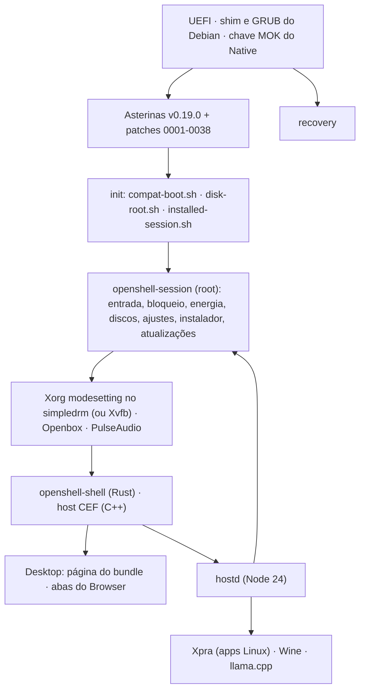

# OpenShell Native — Plano de implementação e estado atual

**Revisão 1.0 · 13 de novembro de 2026.** Substitui a proposta técnica v0.1 de 11 de novembro, cujas etapas 0 a 6 estão concluídas.

OpenShell Native é a edição instalável do OpenShell com kernel em Rust e compatibilidade binária Linux. A base é o Asterinas v0.19.0, mantido como upstream rastreável com uma série de patches. O sistema roda o mesmo bundle do OpenShell Desktop do OpenShell Live (Debian), num shell CEF em vez do Electron ([plano CEF](ARCHITECTURE-CEF.md)), com supervisor, instalador, atualização A/B e recovery próprios. O OpenShell Live continua como edição Debian independente e como controle de comportamento: cada recurso do Native é medido contra o que o Live faz.

## 1. Arquitetura

| Camada | Onde está | O que faz |
| --- | --- | --- |
| Kernel | [kernel/patches](kernel/patches/README.md), revisão em [config/upstream.lock.json](config/upstream.lock.json) | ABI que o Chromium, o Node, o Python, o Xorg, o Xpra e o Wine usam, com o sandbox do Chromium efetivo; drivers de PC (seção 3). Cada patch registra o workload, o teste e a situação upstream. |
| Composição | [userspace/compatibility/initramfs.nix](userspace/compatibility/initramfs.nix) | Closure Nix do sistema a partir do nixpkgs fixado do Asterinas: Node, Python, Xorg, Mesa, CEF, PulseAudio, Xpra, Wine, llama.cpp, fontes. Mesmo binário para ISO, imagem instalada e testes. |
| Init e boot | `userspace/compatibility/probes/*.sh`, [distro/image](distro/image) | Boot da mídia live e do sistema instalado, cópia do sistema para a partição de dados, montagem de `data`, trial e confirmação do slot. |
| Supervisor e shell | [userspace/shell](userspace/shell) | `openshell-session` (root) responde à sessão por sockets com credencial do par: senha, bloqueio, energia, discos, ajustes, instalador, atualizações. `openshell-shell` inicia o `hostd` e o host CEF; a política de navegação é a biblioteca Rust que o host CEF consulta. |
| A/B | [distro/ab](distro/ab) | Seletor redundante, manifesto assinado (Ed25519), staging do slot inativo, trial com contagem, confirmação e recovery. |
| Desktop | repositório `openshell`, `apps/desktop` | O bundle é o mesmo do Live. No Native, `src/host/native*.ts` implementa a interface do processo principal do Electron sobre a ponte do shell, e `hostd/native/*` adapta os serviços que no Live dependem do Debian (systemd, udisks, NetworkManager, journald). |

## 2. Repositórios e build

| Repositório | Responsabilidade |
| --- | --- |
| `openshell` | Desktop, `hostd`, contrato `@openshell/host-api`, UI compartilhada. Exporta o bundle Linux (`pnpm desktop:bundle`). |
| `openshelllive` | ISO Debian do OpenShell Live: controle e edição independente. |
| `openshell-native` | Patches do kernel, composição, supervisor e shell, imagens, A/B, recovery e testes de sistema. Consome o bundle do Desktop. |

O build roda num contêiner Linux (Docker; no Windows, Docker Desktop no modo Linux) com a imagem oficial do Asterinas fixada. A série de patches aplica do zero a cada build, verificada com `git diff --check`, e os testes rodam no QEMU com OVMF e TCG. As ações de [tools/build/native.mjs](tools/build/native.mjs) e o [README](README.md#sondas-e-builds-de-desenvolvimento) listam os comandos; `make iso` e `make install-image` geram as mídias.

## 3. Estado por área

Resultados no QEMU, salvo indicação, e no piloto de hardware em andamento. O [README](README.md#paridade-com-o-openshell-live) compara cada recurso com o Live.

| Área | Estado | Lacunas |
| --- | --- | --- |
| Boot e Secure Boot | Shim e GRUB do Debian, kernel assinado com a chave do Native inscrita uma vez no MokManager; tela de carregamento até o Desktop. | Carregador UEFI próprio fica fora: o GRUB cobre seleção de slot e recovery. |
| ABI e sandbox | Chromium com seccomp-bpf e namespaces de usuário, PID e rede; Node, Python, Xorg, Xpra e Wine. | `ip route add` (netlink `RTM_NEWROUTE`), journald e serviços systemd. |
| Tela e entrada | Xorg sobre DRM (simpledrm) com Mesa em software; teclado PS/2 e USB, touchpads Synaptics e ELAN, mouse USB, hubs; brilho Intel. | Aceleração de GPU, dois monitores, touchpads I2C-HID, brilho AMD, IME. |
| Armazenamento | VirtIO, NVMe, SATA (AHCI, patch 0037) e USB (Bulk-Only); ext2, exFAT e FAT12/16/32; `/sys/block`, `/proc/partitions`, `/proc/diskstats`; montagem pelo Desktop. | NTFS, UAS, NCQ, unidades ópticas. |
| Rede | VirtIO, Intel e1000/e1000e/igb/igc, Realtek RTL8111/8168/8125, ancoragem USB (ECM, NCM, RNDIS); DHCP no kernel, rotas pelo netlink, `/proc/net/{route,dev,pnp}`. | Wi-Fi, adaptadores USB com chip próprio (ASIX, RTL815x), IPv6 por SLAAC/DHCPv6, firewall (netfilter). |
| Som | Intel HDA com o caminho genérico de codecs, ALSA em `/dev/snd`, PulseAudio da sessão; volume, microfone e troca para o fone. | HDMI/DisplayPort, ajustes por modelo, microfones digitais (SOF). |
| Sessão | Entrada com senha, bloqueio, desligar e reiniciar, instalador, ajustes (fuso, nome, teclado, brilho), discos, logs, processos e desempenho. | Suspensão, impressoras, Bluetooth. |
| Desktop | Desktop, Files, Terminal, Browser com abas nativas, apps Linux (Xpra) e Windows (Wine), modelos locais (llama.cpp b11960 na CPU), ditado (Whisper) e leitura em voz (Piper) na página, dicas no tema. | Paridade de serviços que dependem do Debian (NetworkManager, udisks, journald) é por adaptadores, somente leitura onde o Native não tem o serviço. |
| Dados e atualização | Imagem GPT com `system_a`, `system_b`, `recovery` e `data`; instalação em NVMe, SATA, USB ou VirtIO; atualização assinada do slot inativo pelo canal de releases; trial de 3 boots e retorno. | Criptografia de disco, snapshots. |

## 4. Roadmap

| Etapa | Estado | Evidência |
| --- | --- | --- |
| 0 · Inventário e baseline | Concluída | Lock do upstream, bundle e sondas de controle no Linux. |
| 1 · Kernel no QEMU | Concluída | Boots repetidos com console, disco e rede. |
| 2 · Userspace compatível | Concluída | Sondas de Node, Python, PTY, VFS, inotify, DNS/TLS e IPC aprovadas (README, *Estado da compatibilidade*). |
| 3 · Gráficos e navegador | Concluída, com CEF no lugar do Electron | `cef-smoke` (janela, entrada, Worker, isolamento) com o sandbox efetivo. |
| 4 · Desktop integrado | Concluída | `shell-smoke`, `hostd-smoke`, testes de contrato do `host-api`. |
| 5 · Supervisor e sessão | Concluída | `session-smoke`, entrada e bloqueio com senha, reinícios recuperados. |
| 6 · Imagem e recuperação | Concluída | Imagem A/B com atualização, trial, retorno e recovery em VirtIO e NVMe (`boot-test.sh`, que nesta revisão ganhou o caso SATA, ainda a rodar); instalador live. |
| 7 · Hardware de referência | Em andamento | Primeiros testes em notebook físico. Drivers de PC acrescentados dos patches 0027 em diante (teclado, brilho, USB, rede, som, SATA): falta conferir cada um em máquinas reais. |
| 8 · Conectividade sem fio | Planejada | Exige o chip de cada máquina (`lspci -nn`, `lsusb` no Live) e o firmware do linux-firmware. |
| 9 · Periféricos e serviços | Planejada | Impressão, firewall, suspensão, aceleração de GPU. |

### Próximos passos, em ordem

1. **Conferir no hardware o que já passa no QEMU.** Instalação e boot num disco SATA; Ethernet Intel I219, I211/I225 e Realtek RTL8111/8125 (sem emulação no QEMU); som nos codecs Realtek, Conexant e Cirrus; ancoragem USB de celulares; modelos locais com um GGUF do catálogo na imagem.
2. **Wi-Fi Intel, por etapas testadas no notebook.** Carregamento de firmware no kernel, driver PCIe do iwlwifi (família MVM) até a varredura; associação a redes abertas e WPA2 com endereço por DHCP; lista e conexão na página Rede. Depois, Realtek, MediaTek e Qualcomm.
3. **Bluetooth.** HCI por USB (btusb) e sockets `AF_BLUETOOTH` com a interface de gerenciamento que o BlueZ usa; firmware Intel e Realtek.
4. **Firewall e impressão.** Netfilter mínimo para as regras que a página Firewall aplica; CUPS com os drivers que o Live empacota.
5. **Desempenho.** MSI (patch 0037) também no som e nas placas de rede, que hoje são lidos pelo timer; NCQ no SATA; IPv6 por SLAAC.

## 5. Segurança e robustez

O kernel não usa `unsafe` nos componentes acrescentados (`#![deny(unsafe_code)]`), e o que vem de fora é limitado antes de usado. A revisão de 13/11/2026 conferiu as entradas que um dispositivo, a rede ou um programa controlam e corrigiu:

- **Som (patch 0038).** Os controles que os programas criam ficam limitados a 32 por placa, como o `MAX_USER_CONTROLS` do Linux; os ponteiros dos ioctls entram em aritmética verificada (`EFAULT`).
- **DHCP (patch 0038).** O domínio que o servidor manda só entra no `resolv.conf` (`/proc/net/pnp`) se for um nome; antes, uma quebra de linha acrescentava linhas e um byte que não é texto esvaziava o arquivo inteiro.
- **Atualização.** Os membros do arquivo de release precisam sair como arquivos comuns, nunca links, antes de o `openshell-ab` conferir a assinatura.
- **Instalação.** O instalador aceita discos SATA e USB inteiros, mas nunca a mídia live da qual o sistema iniciou (volume ISO 9660 `OPENSHELL_NATIVE`).

Já conferidos e sem mudança: o FAT (boot sector validado, cadeias fora do volume tratadas como quebradas, ciclos limitados ao número de clusters), os quadros USB de rede (tabelas NCM limitadas, fatias por `get`), os comprimentos que as placas de rede escrevem (limitados ao buffer), o socket do supervisor (só o usuário da sessão, pedidos limitados e com timeout), as montagens (pasta de root, `nosuid,nodev`, rótulo saneado) e os ajustes (fuso sem `..`, teclado sem linhas extras, nome sem separadores do `passwd`).

## 6. Decisões

| Decisão | Situação |
| --- | --- |
| Asterinas como base | Adotada: a ABI e o sandbox bastam para o Desktop, os apps Linux e o Wine. |
| CEF no lugar do Electron | Adotada ([plano CEF](ARCHITECTURE-CEF.md)): o Electron Linux continua como referência de comportamento no Live. |
| Composição pelo nixpkgs do Asterinas | Adotada: closure única para ISO, imagem e testes, com os pacotes que o Live tem em versões próximas. |
| Boot pelo shim e GRUB do Debian | Adotada: Secure Boot sem carregador próprio; o GRUB lê o `grubenv` da partição de dados para o trial. |
| Filesystem dos dados | Adotado ext2 nos slots e na partição de dados; journaling, snapshots e criptografia ficam para avaliação. |
| Drivers no kernel, um por família | Adotada: cada família (HDA, e1000, igb, r8169, xHCI, AHCI) num componente próprio com polling ou MSI, testada no QEMU onde há emulação e no hardware do piloto onde não há. |
| `hostd` em Rust | Condicionada aos testes de contrato do `host-api`, método a método. |
