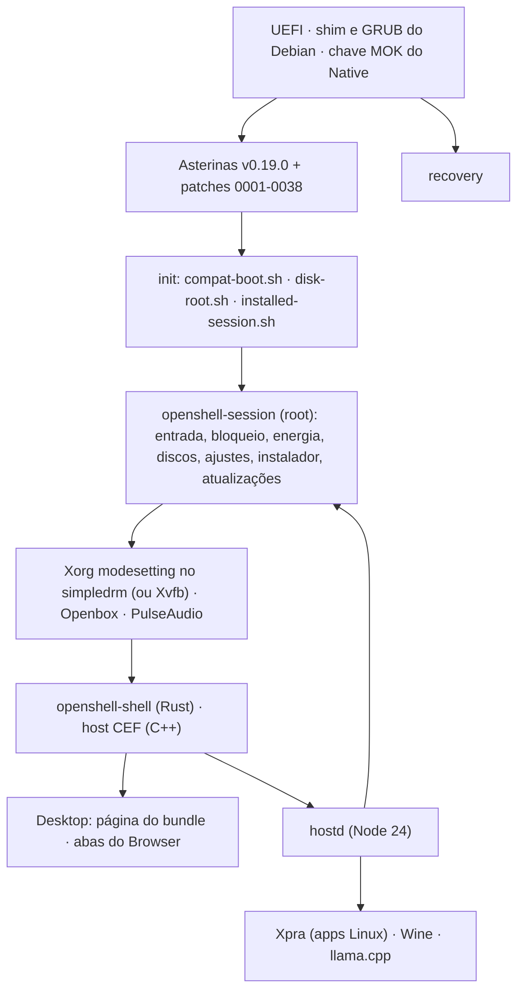

# OpenShell Native — Plano de implementação e estado atual

**Revisão 1.3 · 15 de novembro de 2026.** Substitui a proposta técnica v0.1 de 11 de novembro, cujas etapas 0 a 6 estão concluídas. A 1.1 acrescentou o Wi-Fi acima do chip (patches 0039 a 0041); a 1.2, interrupções na rede e no som, o firewall e os servidores em todos os endereços (patches 0042 a 0044), o SSH, o compartilhamento de tela e a impressão testados no QEMU, a primeira parte do driver Wi-Fi da Intel, desligada por padrão (patch 0045), o `poll` com o mesmo arquivo duas vezes (patch 0046), o fim de dois laços que ocupavam um processador cada (Xorg e hostd, a causa do Desktop parado no hardware, patch 0047), UDP em todos os endereços, multicast IPv4 e ARP que guarda os pacotes enquanto pergunta (patch 0048), e o FUSE, com o NTFS pelo ntfs-3g (patch 0049). A 1.3 traz os drivers Wi-Fi dos quatro fabricantes principais sobre uma camada LinuxKPI (patch 0057): a Intel como rádio, ligada por padrão, das famílias 7000, 8000 e 9000 às AX (0058), MediaTek MT7921/7922 (0059), Realtek RTL8821CE, RTL8822BE e RTL8822CE (0060) e Qualcomm QCA6174/QCA9377 (0061), ainda sem teste em placa real; depois, na mesma revisão, a Intel BE200 (API MLD), o MediaTek MT7925, os canais de 40 MHz ou mais com VHT e HE, o modo ponto de acesso com o hotspot (NAT e DHCP no kernel, patch 0062), o Realtek rtw89 com a RTL8922AE (0063), o Qualcomm ath11k (0064) e a Broadcom FullMAC (0065).

OpenShell Native é a edição instalável do OpenShell com kernel em Rust e compatibilidade binária Linux. A base é o Asterinas v0.19.0, mantido como upstream rastreável com uma série de patches. O sistema roda o mesmo bundle do OpenShell Desktop do OpenShell Live (Debian), num shell CEF em vez do Electron ([plano CEF](ARCHITECTURE-CEF.md)), com supervisor, instalador, atualização A/B e recovery próprios. O OpenShell Live continua como edição Debian independente e como controle de comportamento: cada recurso do Native é medido contra o que o Live faz.

## 1. Arquitetura

| Camada | Onde está | O que faz |
| --- | --- | --- |
| Kernel | [kernel/patches](kernel/patches/README.md), revisão em [config/upstream.lock.json](config/upstream.lock.json) | ABI que o Chromium, o Node, o Python, o Xorg, o Xpra e o Wine usam, com o sandbox do Chromium efetivo; drivers de PC (seção 3). Cada patch registra o workload, o teste e a situação upstream. |
| Composição | [userspace/compatibility/initramfs.nix](userspace/compatibility/initramfs.nix) | Closure Nix do sistema a partir do nixpkgs fixado do Asterinas: Node, Python, Xorg, Mesa, CEF, PulseAudio, Xpra, Wine, llama.cpp, fontes. Mesmo binário para ISO, imagem instalada e testes. |
| Init e boot | `userspace/compatibility/probes/*.sh`, [distro/image](distro/image) | Boot da mídia live e do sistema instalado, cópia do sistema para a partição de dados, montagem de `data`, trial e confirmação do slot. |
| Supervisor e shell | [userspace/shell](userspace/shell) | `openshell-session` (root) responde à sessão por sockets com credencial do par: senha, bloqueio, energia, discos, ajustes, instalador, atualizações. `openshell-shell` inicia o `hostd` e o host CEF; a política de navegação é a biblioteca Rust que o host CEF consulta. |
| A/B | [distro/ab](distro/ab) | Seletor redundante, manifesto assinado (Ed25519), staging do slot inativo, trial com contagem, confirmação e recovery. |
| Desktop | repositório `openshell`, `apps/desktop` | O bundle é o mesmo do Live. No Native, `src/host/native*.ts` implementa a interface do processo principal do Electron sobre a ponte do shell, e `hostd/native/*` adapta os serviços que no Live dependem do Debian (systemd, udisks, NetworkManager, journald). |

## 2. Repositórios e build

| Repositório | Responsabilidade |
| --- | --- |
| `openshell` | Desktop, `hostd`, contrato `@openshell/host-api`, UI compartilhada. Exporta o bundle Linux (`pnpm desktop:bundle`). |
| `openshelllive` | ISO Debian do OpenShell Live: controle e edição independente. |
| `openshell-native` | Patches do kernel, composição, supervisor e shell, imagens, A/B, recovery e testes de sistema. Consome o bundle do Desktop. |

O build roda num contêiner Linux (Docker; no Windows, Docker Desktop no modo Linux) com a imagem oficial do Asterinas fixada. A série de patches aplica do zero a cada build, verificada com `git diff --check`, e os testes rodam no QEMU com OVMF e TCG. As ações de [tools/build/native.mjs](tools/build/native.mjs) e o [README](README.md#sondas-e-builds-de-desenvolvimento) listam os comandos; `make iso` e `make install-image` geram as mídias.

## 3. Estado por área

Resultados no QEMU, salvo indicação, e no piloto de hardware em andamento. O [README](README.md#paridade-com-o-openshell-live) compara cada recurso com o Live.

| Área | Estado | Lacunas |
| --- | --- | --- |
| Boot e Secure Boot | Shim e GRUB do Debian, kernel assinado com a chave do Native inscrita uma vez no MokManager; o menu do pendrive é o do Live (Live, instalar, atualizar sem perder arquivos, mais opções), com o mesmo tema; tela de carregamento até o Desktop. | Carregador UEFI próprio fica fora: o GRUB cobre seleção de slot e recovery. |
| ABI e sandbox | Chromium com seccomp-bpf e namespaces de usuário, PID e rede; Node, Python, Xorg, Xpra e Wine. | `ip route add` (netlink `RTM_NEWROUTE`), journald e serviços systemd. |
| Tela e entrada | Xorg sobre DRM (simpledrm) com Mesa em software; teclado PS/2 e USB, touchpads Synaptics e ELAN, mouse USB, hubs; brilho Intel. | Aceleração de GPU, dois monitores, touchpads I2C-HID, brilho AMD, IME. |
| Armazenamento | VirtIO, NVMe, SATA (AHCI, patch 0037) e USB (Bulk-Only); ext2, exFAT e FAT12/16/32; NTFS pelo ntfs-3g e qualquer sistema de arquivos FUSE (`/dev/fuse`, patch 0049); `/sys/block`, `/proc/partitions`, `/proc/diskstats`; montagem pelo Desktop. | UAS, NCQ, unidades ópticas. |
| Rede | VirtIO, Intel e1000/e1000e/igb/igc, Realtek RTL8111/8168/8125, ancoragem USB (ECM, NCM, RNDIS); DHCP no kernel, rotas pelo netlink, `/proc/net/{route,dev,pnp}`; sockets `AF_PACKET`; servidores TCP e UDP em `0.0.0.0` (patches 0044 e 0048), multicast IPv4 com `IP_PKTINFO` (patch 0048); sockets TCP IPv6 de pilha dupla sobre o IPv4 (`[::]`, `::1`, endereços mapeados, `IPV6_V6ONLY`, patch 0051); firewall de entrada com estado em `/proc/net/firewall` (patch 0043). Wi-Fi acima do chip: nl80211 por netlink genérico, `wpa_supplicant` sem alteração, pedidos da sessão pelo supervisor, página Rede (testado com o rádio simulado `wlan.sim`); drivers Wi-Fi com WPA2, a 40/80/160 MHz com HT, VHT e HE (20 MHz nas Intel 7000 a 9000), 6 GHz onde o chip tem, EHT na BE200, MT7925 e RTL8922AE, block ack e economia de energia, as calibrações das Realtek 802.11ax pelo host, sobre a camada LinuxKPI (patch 0057): Intel 7260 a AX411 e BE200 (patches 0045 e 0058), MediaTek MT7921/7922/7920/7925 (0059), Realtek RTL8821CE/8822BE/8822CE/8723DE (0060) e RTL8852AE/BE/BTE/CE, RTL8851BE e RTL8922AE (0063), Qualcomm QCA6174/QCA6164/QCA9377 (0061) e QCA6390/WCN6855/QCA2066/QCA6698AQ/QCN9074 (0064), Broadcom FullMAC PCIe (0065); ponto de acesso do nl80211 para o hostapd e hotspot com NAT e DHCP no kernel (0058, 0062). | Os drivers Wi-Fi conferidos em placa real; MLO, adaptadores USB com chip próprio (ASIX, RTL815x), IPv6 por SLAAC/DHCPv6, servidores em `::`, IGMP e multicast IPv6, regras de saída no firewall. |
| Som | Intel HDA com o caminho genérico de codecs, ALSA em `/dev/snd`, PulseAudio da sessão; volume, microfone e troca para o fone. Áudio USB (USB Audio 1.0 e 2.0 sobre as transferências isócronas do xHCI, patch 0053): fones, headsets, caixas e placas viram placas do ALSA ao serem ligados, e o PulseAudio passa a eles. | HDMI/DisplayPort, ajustes por modelo, microfones digitais (SOF), aparelhos USB de feedback implícito. |
| Sessão | Entrada com senha, bloqueio, desligar e reiniciar, instalador, ajustes (fuso, nome, teclado, brilho), discos, logs, processos e desempenho; firewall, SSH e Wi-Fi a pedido da sessão, pelo supervisor; tela compartilhada (x11vnc) e impressão (CUPS, impressoras de rede pelo endereço e as descobertas, impressoras USB pelo `ipp-usb` e pelo backend `usb`, com os dispositivos USB dados aos programas como no Linux, patch 0052); Bluetooth pelo BlueZ (`bluetoothd` no D-Bus do sistema; no kernel, `AF_BLUETOOTH` com a interface de gerenciamento, conexões, canais L2CAP, pareamento SSP e SMP, `/dev/uhid`, btusb e firmware Intel e Realtek, patch 0050): ligar, nome, visível, procurar, parear, conectar, teclados e mouses. | Suspensão; áudio Bluetooth sem teste com fone real; transferências isócronas USB para programas (o kernel já as faz para o áudio e para a voz do Bluetooth, patches 0053 e 0054). SSH, x11vnc, CUPS (também as impressoras USB) e Bluetooth testados no QEMU, ainda não numa imagem completa. |
| Desktop | Desktop, Files, Terminal, Browser com abas nativas, apps Linux (Xpra) e Windows (Wine), modelos locais (llama.cpp b11960 na CPU), ditado (Whisper) e leitura em voz (Piper) na página, dicas no tema. | Paridade de serviços que dependem do Debian (NetworkManager, udisks, journald) é por adaptadores, somente leitura onde o Native não tem o serviço. |
| Dados e atualização | Imagem GPT com `system_a`, `system_b`, `recovery` e `data`; instalação em NVMe, SATA, USB ou VirtIO, pelo Desktop live ou pela entrada do menu do pendrive; atualização assinada do slot inativo pelo canal de releases ou pelo pendrive (mantendo os arquivos, com volta ao release anterior); trial de 3 boots e retorno. | Criptografia de disco, snapshots. |

## 4. Roadmap

| Etapa | Estado | Evidência |
| --- | --- | --- |
| 0 · Inventário e baseline | Concluída | Lock do upstream, bundle e sondas de controle no Linux. |
| 1 · Kernel no QEMU | Concluída | Boots repetidos com console, disco e rede. |
| 2 · Userspace compatível | Concluída | Sondas de Node, Python, PTY, VFS, inotify, DNS/TLS e IPC aprovadas (README, *Estado da compatibilidade*). |
| 3 · Gráficos e navegador | Concluída, com CEF no lugar do Electron | `cef-smoke` (janela, entrada, Worker, isolamento) com o sandbox efetivo. |
| 4 · Desktop integrado | Concluída | `shell-smoke`, `hostd-smoke`, testes de contrato do `host-api`. |
| 5 · Supervisor e sessão | Concluída | `session-smoke`, entrada e bloqueio com senha, reinícios recuperados. |
| 6 · Imagem e recuperação | Concluída | Imagem A/B com atualização, trial, retorno e recovery em VirtIO e NVMe (`boot-test.sh`, que nesta revisão ganhou o caso SATA, ainda a rodar); instalador live; menu do pendrive do Live e atualização pelo pendrive (`update-test.sh`). |
| 7 · Hardware de referência | Em andamento | Primeiros testes em notebook físico. Drivers de PC acrescentados dos patches 0027 em diante (teclado, brilho, USB, rede, som, SATA): falta conferir cada um em máquinas reais. |
| 8 · Conectividade sem fio | Planejada | Exige o chip de cada máquina (`lspci -nn`, `lsusb` no Live) e o firmware do linux-firmware. |
| 9 · Periféricos e serviços | Em andamento | Firewall no kernel (patch 0043), SSH, compartilhamento de tela e impressão, testados no QEMU. Faltam suspensão e aceleração de GPU. |

### Próximos passos, em ordem

1. **Conferir no hardware o que já passa no QEMU.** Instalação e boot num disco SATA; o menu do pendrive (Live, Install, Update, More options) e a atualização de um sistema instalado por ele, depois de gerar o pendrive com a chave de release; Ethernet Intel I219, I211/I225 e Realtek RTL8111/8125 (sem emulação no QEMU); som nos codecs Realtek, Conexant e Cirrus; um fone ou headset USB (o log do kernel diz `sound card N: <produto> (USB Audio 1.0/2.0)` e o PulseAudio passa a ele); ancoragem USB de celulares; modelos locais com um GGUF do catálogo na imagem.
2. **Drivers dos chips Wi-Fi, cada um conferido em hardware.** A parte comum está pronta (componente `aster-wlan`, patches 0039 a 0041): um driver só implementa as operações de `radio::Radio`. Intel primeiro, por ser a mais comum: o firmware -77 fala o mesmo conjunto de comandos em AX200, AX201, AX210 e AX211, que por isso saem de um só driver. O que os drivers traduzidos do Linux têm em comum (bits, esperas, PCI, MSI-X, DMA, firmware) é uma camada LinuxKPI (`aster-linuxkpi`, patch 0057). Escritos (falta conferir cada um numa placa real, lendo no log do kernel até onde ela chega): Intel (`aster-iwlwifi`, patches 0045 e 0058: transporte PCIe de segunda geração para as AX e as BZ (BE200, pela API MLD do firmware) e de primeira para as famílias 9000, 8000 e 7000, com o programa de calibração, as filas do host e o controle de taxa do driver; `alive`, os comandos de início, varredura UMAC, associação, chaves e dados), MediaTek MT7921/7922/7920 e MT7925 (`aster-mt7921`, patch 0059), Realtek RTL8821CE, RTL8822BE, RTL8822CE e RTL8723DE, também nos adaptadores USB (`aster-rtw88`, patch 0060, com a interface de drivers USB do kernel em `aster-usb`) e as do rtw89, RTL8852AE/BE/BTE/CE, RTL8851BE e a RTL8922AE de outra geração (`aster-rtw89`, patch 0063), Qualcomm QCA6174/QCA9377 (`aster-ath10k`, patch 0061) e as ath11k, com MHI, QRTR e QMI próprios (`aster-ath11k`, patch 0064), e Broadcom FullMAC (`aster-brcmfmac`, patch 0065). 40/80/160 MHz com VHT e HE (as Intel 7000 a 9000 até 80 MHz); o ponto de acesso (hotspot), block ack, economia de energia e 802.11w em todos; TKIP de grupo nas Realtek, MediaTek e Qualcomm; 6 GHz onde o chip tem e EHT na BE200, na MT7925 e na RTL8922AE; as Realtek 802.11ax calibradas pelo host (`rtw8852*_rfk`, `rtw8851b_rfk`). Depois: conferir em placa real, MLO.
3. **Bluetooth no hardware.** O patch 0050 traz o Bluetooth inteiro até o pareamento (componente `aster-bluetooth`: núcleo HCI, interface de gerenciamento numa tarefa própria, conexões ACL e LE, links SCO e eSCO, canais L2CAP e RFCOMM, SSP, SMP com LE Secure Connections e legado, sockets HCI, L2CAP, RFCOMM e SCO, `/dev/vhci`, `/dev/uhid`, `/dev/rfkill`, btusb, firmware Intel e Realtek, `AF_ALG`), testado no QEMU com o BlueZ dos dois lados e com as suítes de teste do BlueZ para o kernel. **Primeiro teste em hardware**: o log do kernel (linhas `Bluetooth: hci0`) diz se o firmware carregou; a página Bluetooth deve listar os dispositivos por perto, parear um mouse ou teclado e ele funcionar; depois um fone (A2DP pelo PulseAudio). A voz das chamadas pelos adaptadores USB (SCO nas transferências isócronas, patch 0054) passa no QEMU; no hardware, uma chamada com um headset (o log do kernel diz `hci0: voice ...: setting N`). Faltam os chips MediaTek, Qualcomm e Broadcom e os Intel por PCIe.
4. **Conferir os serviços novos numa imagem e no hardware.** SSH, tela compartilhada e impressão passam no QEMU (cada um com o programa real e clientes de fora); falta o boot de uma imagem completa e uma impressora de verdade. A descoberta de impressoras na rede (Avahi, D-Bus do sistema, nss-mdns; kernel no patch 0048) e as impressoras USB (`ipp-usb` e o backend `usb` do CUPS sobre o usbfs do patch 0052) passam no QEMU com impressoras simuladas; falta uma impressora de verdade, de rede e USB. Servidores em `::` sobem desde o patch 0051 (IPv6 de pilha dupla sobre o IPv4).
5. **Desempenho.** As placas de rede e o som já avisam por interrupção (MSI, patch 0042), com o temporizador como reserva até a primeira chegar: conferir em hardware com `/proc/interrupts`. Depois NCQ no SATA e IPv6 por SLAAC.

## 5. Segurança e robustez

O kernel não usa `unsafe` nos componentes acrescentados (`#![deny(unsafe_code)]`), e o que vem de fora é limitado antes de usado. A revisão de 13/11/2026 conferiu as entradas que um dispositivo, a rede ou um programa controlam e corrigiu:

- **Som (patch 0038).** Os controles que os programas criam ficam limitados a 32 por placa, como o `MAX_USER_CONTROLS` do Linux; os ponteiros dos ioctls entram em aritmética verificada (`EFAULT`).
- **DHCP (patch 0038).** O domínio que o servidor manda só entra no `resolv.conf` (`/proc/net/pnp`) se for um nome; antes, uma quebra de linha acrescentava linhas e um byte que não é texto esvaziava o arquivo inteiro.
- **Atualização.** Os membros do arquivo de release precisam sair como arquivos comuns, nunca links, antes de o `openshell-ab` conferir a assinatura.
- **Instalação.** O instalador aceita discos SATA e USB inteiros, mas nunca a mídia live da qual o sistema iniciou (volume ISO 9660 `OPENSHELL_NATIVE`). Com o manifesto assinado da mídia, confere o que o computador leu do pendrive antes de gravar.
- **Atualização pelo pendrive.** O release da mídia só entra num sistema instalado depois que `openshell-ab update-offline` confere a assinatura do manifesto e cada arquivo gravado; o slot em uso nunca é tocado, e a versão nova roda em teste, com volta à anterior.

Já conferidos e sem mudança: o FAT (boot sector validado, cadeias fora do volume tratadas como quebradas, ciclos limitados ao número de clusters), os quadros USB de rede (tabelas NCM limitadas, fatias por `get`), os comprimentos que as placas de rede escrevem (limitados ao buffer), o socket do supervisor (só o usuário da sessão, pedidos limitados e com timeout), as montagens (pasta de root, `nosuid,nodev`, rótulo saneado) e os ajustes (fuso sem `..`, teclado sem linhas extras, nome sem separadores do `passwd`).

## 6. Decisões

| Decisão | Situação |
| --- | --- |
| Asterinas como base | Adotada: a ABI e o sandbox bastam para o Desktop, os apps Linux e o Wine. |
| CEF no lugar do Electron | Adotada ([plano CEF](ARCHITECTURE-CEF.md)): o Electron Linux continua como referência de comportamento no Live. |
| Composição pelo nixpkgs do Asterinas | Adotada: closure única para ISO, imagem e testes, com os pacotes que o Live tem em versões próximas. |
| Boot pelo shim e GRUB do Debian | Adotada: Secure Boot sem carregador próprio; o GRUB lê o `grubenv` da partição de dados para o trial. |
| Filesystem dos dados | Adotado ext2 nos slots e na partição de dados; journaling, snapshots e criptografia ficam para avaliação. |
| Drivers no kernel, um por família | Adotada: cada família (HDA, e1000, igb, r8169, xHCI, AHCI) num componente próprio com MSI e varredura como reserva, testada no QEMU onde há emulação e no hardware do piloto onde não há. |
| `hostd` em Rust | Condicionada aos testes de contrato do `host-api`, método a método. |
